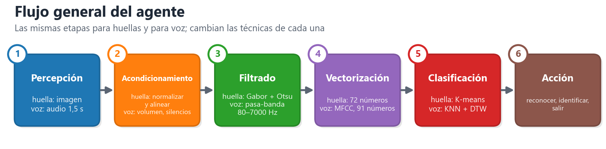
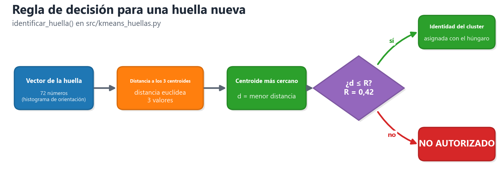
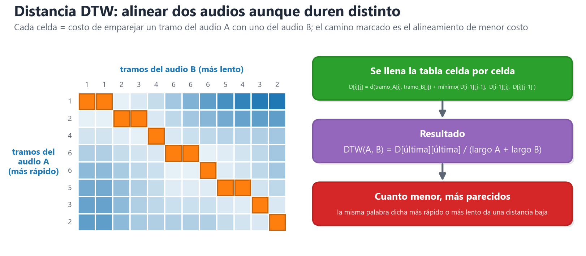
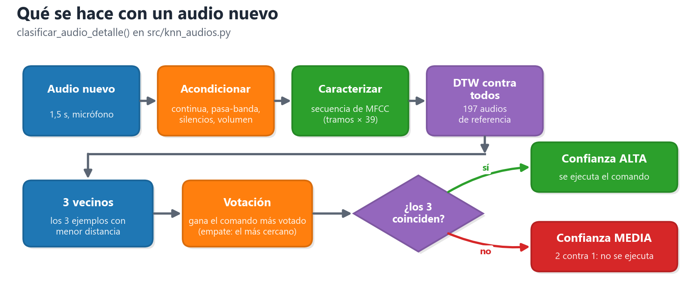
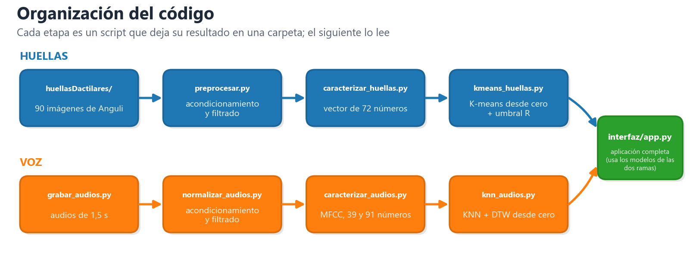
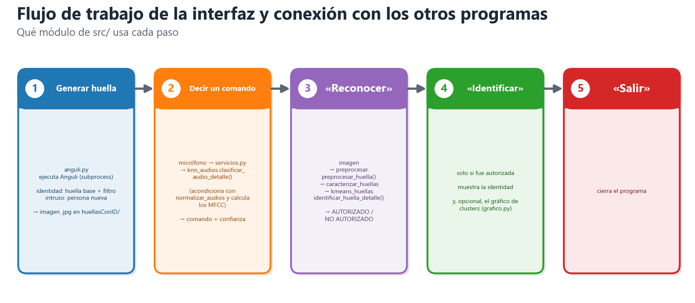
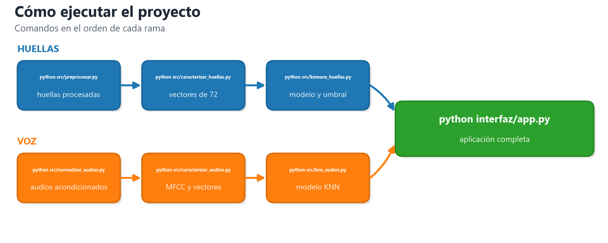

# Trabajo Final Inteligencia Artificial I – año 2026: Sistema de reconocimiento de huellas dactilares controlado por reconocimiento de voz

> **Estado: borrador de trabajo.** Se completa de a poco con las palabras del equipo. Los textos marcados con **[completar]** son huecos para escribir; lo demás es un primer orden de las ideas ya explicadas.
> Por ahora están desarrolladas las dos secciones pedidas: **Diseño del agente** (algoritmos de cada etapa) y **Código** (descripción general y uso de IA generativa).

---

# Resumen

Se desarrolló un agente de control de acceso biométrico que identifica a tres personas autorizadas a partir de su huella dactilar, rechaza intrusos y se opera con comandos de voz. Los datos son sintéticos: 90 huellas generadas con Anguli (3 identidades y 6 efectos de distorsión) y 197 audios grabados. Las huellas se acondicionan (normalización, alineación, filtro de Gabor orientado y binarización de Otsu), se representan con un vector de 72 números (histograma de orientación de crestas) y se clasifican con K-means (k = 3),, con un umbral de rechazo sobre la distancia al centroide (R = 0,42). Los audios se filtran, se normalizan, se caracterizan con MFCC y se clasifican con KNN (K = 3) usando distancia DTW. K-means alcanzó 88,9 % de exactitud en prueba y el KNN 90,9 % (96,7 % de punta a punta). Una interfaz integra todo. El análisis por componentes principales muestra tres grupos por identidad en las huellas y solapamiento entre comandos en la voz. El sistema funciona bien con distorsiones moderadas; sus límites son las huellas muy recortadas, el uso de datos sintéticos y que el KNN no rechaza palabras desconocidas, a mejorar.

---

# Introducción

La **visión artificial** es la rama de la IA que permite a una computadora "ver": a partir de una imagen obtiene información útil (formas, texturas, patrones). En este trabajo se aplica a las **huellas dactilares**: se mejora la imagen, se extraen características (la orientación de las crestas) y se decide a qué persona pertenece. El **reconocimiento de voz** hace lo mismo con el sonido: convierte la señal del micrófono en características que describen cómo suena (MFCC) y decide qué palabra se dijo.

**Problema a resolver:** construir un agente inteligente de **control de acceso biométrico** que (1) identifique a una de **3 personas autorizadas** a partir de su huella, (2) **rechace a los intrusos** (huellas de personas no registradas) y (3) obedezca **comandos de voz** (*reconocer*, *identificar*, *salir*) para operar el sistema. Las huellas se agrupan con **K-means** y los comandos se clasifican con **KNN + DTW**.

---

# Especificación del agente

## Tipo de agente

Según la clasificación de la Clase 1, el agente es **reactivo basado en modelos**, con componentes que **aprendieron de datos**.

- **Reactivo (reglas condición → acción):** ante una percepción (huella o comando) clasifica y ejecuta una acción de forma directa, sin planificar ni maximizar una utilidad.
- **Basado en modelos (estado interno):** guarda qué pasó antes: si hay una huella cargada y si ya fue *reconocida*. Por eso el comando *identificar* solo funciona después de *reconocer*, algo que un agente reactivo simple (que mira solo la percepción actual) no podría hacer.
- **Modelos aprendidos:** los centroides del K-means y los ejemplos del KNN se obtuvieron del entrenamiento; son el "conocimiento" del agente. El aprendizaje es **previo** (offline): el agente no sigue aprendiendo mientras opera.

## Tabla REAS (Rendimiento, Entorno, Actuadores, Sensores)

| Agente | Medida de rendimiento | Entorno | Actuadores | Sensores |
|---|---|---|---|---|
| **Agente de control de acceso biométrico (huella + voz)** | **Maximizar:** aciertos al identificar (huellas: 88,9 % en prueba; voz: 90,9 % en prueba) y autorizadas aceptadas. **Minimizar:** intrusos aceptados (FAR) y autorizadas rechazadas (FRR). Respuesta en pocos segundos | Usuario frente al puesto de control; huellas de 3 personas autorizadas e intrusos (sintéticas, generadas con Anguli, con giro, traslación, rayones y ruido); ambiente con ruido de fondo | Pantalla de la interfaz (resultado *IDENTIDAD n* / *NO AUTORIZADO*, estado del paso); gráfico de clusters; registro de eventos; cierre del programa (*salir*) | Imagen de la huella (generada con Anguli o cargada de archivo); micrófono USB (audios de 1,5 s, 16 kHz) |

**Justificación breve.** La *medida de rendimiento* se define según lo que se quiere para el entorno (Clase 1): un sistema de acceso falla de dos maneras, dejar entrar a un intruso (FAR) o rechazar a una persona autorizada (FRR), y ambas se miden. El *entorno* es la persona que se presenta con su huella y su voz. Los *sensores* son la imagen y el micrófono; los *actuadores* son la pantalla y el registro, que informan la decisión.

## Propiedades del entorno de trabajo

| Propiedad | Clasificación | Justificación |
|---|---|---|
| **Observable** | **Parcialmente** | El sensor entrega una sola imagen y un solo audio, con ruido, recorte o rayones; el agente no ve la huella completa ni sabe si quien habla es la misma persona de la huella |
| **Determinista / estocástico** | **Estocástico** | La misma persona produce huellas distintas cada vez (giro, desplazamiento, ruido) y dice el comando distinto cada vez; el resultado de una percepción no se puede predecir con certeza |
| **Episódico / secuencial** | **Secuencial** | El flujo depende de lo anterior: *identificar* solo tiene sentido si antes se *reconoció* la huella (se guarda estado). Cada nueva huella reinicia el flujo |
| **Estático / dinámico** | **Estático** | El entorno no cambia mientras el agente procesa: la huella ya está generada y el sistema espera al usuario. (Solo el audio es tiempo real, pero se graba completo antes de clasificar) |
| **Discreto / continuo** | **Continuo** en las percepciones, **discreto** en las acciones | La imagen y la señal de audio son valores continuos; las acciones son un conjunto finito (*reconocer*, *identificar*, *salir*) y las respuestas son 3 identidades o "no autorizado" |
| **Un agente / multiagente** | **Un solo agente** | El usuario (o el intruso) es parte del entorno que genera las percepciones; no hay otro agente cuyo rendimiento dependa del comportamiento del nuestro |

---

# 1. Diseño del agente: algoritmos utilizados en cada etapa

## 1.1 Visión general

El agente es un **sistema de reconocimiento biométrico** que recibe dos tipos de percepción —la **imagen de una huella dactilar** y la **voz del usuario**— y decide qué responder:

| Elemento | En este proyecto |
|---|---|
| **Percepción** | Imagen de una huella (sensor: la imagen generada) y audio del micrófono (comandos de voz) |
| **Procesamiento** | Acondicionamiento → filtrado → vectorización de cada percepción |
| **Decisión** | Huella: **K-means** + umbral de rechazo. Voz: **KNN** con distancia DTW |
| **Acciones** | *Reconocer* (¿es una persona autorizada?), *Identificar* (¿cuál de las 3?), *Salir* |

Las etapas son **las mismas para los dos métodos** (huella y voz); cambian las técnicas de cada una:



---

## 1.2 Método 1: K-means para las huellas dactilares

### a) Datos de partida
- Las huellas se crearon **sintéticamente con el software Anguli**. Se generaron **3 identidades** (huellas base) y, a cada una, se le aplicaron **distintos filtros propios de la aplicación**: traslación, rotación, rayones y ruido, en 6 variantes de 5 impresiones cada una (**90 imágenes en total**).
- *Limitación:* como son filtros nativos de la aplicación, **no se asegura que se parezcan a lo que pasaría con huellas reales** (piel seca, sensores distintos, presión, etc.).

### b) Acondicionamiento de las imágenes
Se aplica **el mismo proceso a cualquier imagen**, sin saber qué distorsión trae. Pasos:

1. **Normalización del contraste:** se estira el rango de grises para que las crestas se vean con más contraste.
2. **Máscara de la zona con crestas:** se separa la huella del fondo blanco para trabajar solo con la parte útil.
3. **Alineación (rotar y trasladar):** se centra la huella en el cuadro y se la gira hasta dejarla vertical, para que una huella desplazada o girada se parezca a su original.

### c) Filtrado
- **Filtro de Gabor orientado.** Una huella es un patrón de líneas (crestas) que van cambiando de dirección. El filtro de Gabor es un "detector de rayas": primero se estima **hacia dónde apuntan las crestas en cada zona** y **cada cuánto se repiten**; después, en cada zona, se aplica un filtro sintonizado a esa dirección. El resultado **refuerza las crestas, rellena cortes y rayones que siguen la dirección de la cresta y elimina el ruido**.
- **Binarización (método de Otsu).** Convierte la imagen de grises en **solo blanco y negro**: el algoritmo elige solo el umbral que mejor separa los píxeles claros de los oscuros; lo oscuro (la cresta) queda **negro** y lo demás **blanco**. Después se limpian las motas sueltas. Así las crestas quedan nítidas para medirlas.

### d) Vectorización (extracción de características)
Una imagen no se puede comparar directamente; hay que resumirla en una **lista de números de largo fijo** (un *vector*). Aquí el vector tiene **72 números** y mide **hacia dónde apuntan las crestas**:

- **24 números:** histograma de orientación de las crestas de **toda** la huella. Los ángulos de 0° a 180° se dividen en 24 rangos de 7,5°; cada número dice **qué fracción de la huella** tiene crestas con esa orientación.
- **4 × 12 = 48 números:** la huella se divide en **4 cuadrantes** (arriba-izquierda, arriba-derecha, abajo-izquierda, abajo-derecha) y en cada uno se arma un histograma de **12 rangos** de 15°. Agrega **dónde** están las orientaciones, no solo cuáles hay.

> Total: 24 + 4 × 12 = **72 números por huella**.

### e) Aplicación de K-means
**K-means** agrupa vectores parecidos en **clusters** (grupos), cada uno con un **centroide** (el "centro" del grupo, el promedio de sus vectores). **No usa las etiquetas** (no sabe de quién es cada huella): agrupa solo por parecido, midiendo la **distancia euclídea** entre vectores.

**Elección de K:** K es la cantidad de grupos. Se usa **K = 3**, porque hay **3 identidades autorizadas** (un cluster por persona). **[completar: confirmar con tus palabras]**

Una vez que tenemos los vectores, se realizan **5 pasos** (con las huellas de entrenamiento):

| Paso | Qué se hace |
|---|---|
| **1. Inicializar** | Se eligen **K = 3 huellas al azar** como centroides iniciales |
| **2. Asignar** | Cada huella se asigna al **centroide más cercano** (distancia euclídea) |
| **3. Recalcular** | Cada centroide se mueve al **promedio** de las huellas de su grupo |
| **4. Reasignar** | Se repiten los pasos 2 y 3 hasta que **ninguna huella cambie de grupo** (el algoritmo *convergió*) |
| **5. Repetir** | Como el resultado depende del azar inicial, todo se repite **10 veces** con centroides iniciales distintos y se **conserva la mejor corrida** (la de menor *inercia*: suma de distancias al cuadrado de cada huella a su centroide) |

### f) De cluster a identidad (algoritmo húngaro)
K-means devuelve clusters numerados 0, 1, 2 **sin saber a quién corresponde cada uno**. Para ponerles nombre se usa el entrenamiento: se **cuenta cuántas huellas de cada identidad cayeron en cada cluster** y se hace una **asignación uno a uno** que maximiza los aciertos.

- **Algoritmo húngaro (explicación breve):** resuelve el problema de emparejar elementos de dos grupos (acá, clusters con identidades) **sin repetir ninguno** y de modo que el **total de aciertos sea el mayor posible**. Evita, por ejemplo, que dos clusters terminen con la misma identidad.

### g) Umbral de rechazo
Hace falta poder decir **"NO AUTORIZADO"**: una huella cuya distancia al centroide más cercano es muy grande no pertenece a ninguna de las 3 personas. Se fija un **radio R** (umbral); hay dos errores posibles al elegirlo:

- **FRR (tasa de falso rechazo):** una persona **autorizada** es rechazada. Se calcula como `huellas autorizadas rechazadas / total de autorizadas`. Un R chico aumenta este error.
- **FAR (tasa de falsa aceptación):** un **intruso** es aceptado. Se calcula como `intrusos aceptados / total de intrusos`. Un R grande aumenta este error.

**Cómo se eligió R:**

1. **Calibración inicial con un script (intrusos simulados).** No había huellas de intrusos, así que se simularon dejando una identidad afuera del entrenamiento (se entrenaba con las otras dos y la tercera hacía de intrusa). Para cada radio de una grilla (de 0,10 a 0,60) se calculaban **FRR** y **FAR**, y se elegía el radio donde **los dos errores se igualan**. Dio **R = 0,31** (~14 % de error en cada sentido).
2. **Calibración con huellas intrusas reales.** Se generaron huellas de personas nuevas con Anguli y se probaron a mano, junto con huellas de autorizadas, **viendo cuándo el programa fallaba** (el script `probar_huellas.py` guarda cada resultado con el feedback del usuario). Con eso se vio que **0,31 rechazaba demasiadas autorizadas** y se subió el umbral a **R = 0,42**, el mayor valor con el que **ningún intruso de las pruebas fue aceptado**. Funciona mejor.

### h) Regla de decisión para una huella nueva
Implementada en `clasificar()` / `identificar_huella()`:

1. Calcular la distancia a los 3 centroides y quedarse con el **más cercano**.
2. Si esa distancia es **menor o igual al radio R** → se **acepta** con la identidad de ese cluster.
3. Si es **mayor** → **"NO AUTORIZADO"**.



```python
# resumen del código (src/kmeans_huellas.py)
def identificar_huella(vector, modelo):
    d = distancia_a_cada_centroide(vector, modelo.centroides)   # 3 distancias
    j = indice_del_menor(d)                                     # centroide más cercano
    if d[j] > modelo.R:                                         # R = 0,42
        return "NO AUTORIZADO"
    return identidad_del_cluster[j]                             # asignada con el algoritmo húngaro
```

---

## 1.3 Método 2: KNN para los comandos de voz

### a) Obtención de los datos
Se tomaron muestras de voz de **8 sesiones de grabación (personas o condiciones distintas)** **[completar: cantidad de personas]**, con un total de **197 muestras** para los 3 comandos (*reconocer* 60, *identificar* 76, *salir* 61). Todas se grabaron **con el mismo micrófono**, con un **script de Python** que toma audios de **1,5 segundos** (16 kHz, mono). Se usó el mismo micrófono que se usa en la demo para que las diferencias entre audios se deban a la palabra y no al equipo.

### b) Acondicionamiento
Cada audio crudo se deja "en condiciones" antes de analizarlo:

1. **Quitar la componente continua:** se resta el promedio de la señal, para que el audio oscile alrededor de cero (sin "desplazamiento" por el micrófono).
2. **Recorte de silencios por energía:** se mide la energía en tramos cortos y se **descarta lo que no es voz** (el silencio del principio y del final), dejando 100 ms de margen. Así el silencio no influye en la comparación.
3. **Normalización de volumen:** se lleva el volumen de la voz a un nivel fijo (**RMS a −20 dBFS**: el RMS es el volumen promedio), con un **limitador de pico** que evita que el audio sature. Así un audio grabado más cerca o más lejos del micrófono queda comparable.

### c) Filtrado
**Filtro pasa-banda Butterworth de 80 a 7000 Hz, de fase cero:** deja pasar solo las frecuencias entre 80 y 7000 Hz, que es donde está la voz. **Elimina zumbidos graves** (por ejemplo el de la corriente eléctrica) **y ruido muy agudo**. Es "de fase cero" porque se aplica una vez hacia adelante y otra hacia atrás, de modo que **no desplaza el sonido en el tiempo**.

### d) Caracterización (de la señal a números)
Un audio no se puede comparar directamente (son miles de valores y dos personas nunca dicen la palabra igual). Se lo convierte en números que describen **cómo suena** (el timbre). Pasos, que dan los llamados **MFCC**:

| Paso | Qué hace (breve) |
|---|---|
| **Pre-énfasis** | Refuerza un poco los sonidos agudos, que en la voz son más débiles, para que no queden tapados por los graves |
| **Ventanas de 25 ms** | La voz cambia muy rápido, así que se la corta en **tramos de 25 ms, uno cada 10 ms** (superpuestos), y en cada tramo se suavizan los bordes (ventana de Hamming) |
| **FFT** | Calcula **qué frecuencias** (graves/agudos) hay en cada tramo y con qué fuerza |
| **40 filtros Mel** | Agrupa las frecuencias en **40 bandas** siguiendo la escala Mel, que imita al oído humano (distingue mucho entre graves y poco entre agudos) |
| **Logaritmo** | Comprime la energía de cada banda, como percibe el volumen el oído |
| **DCT** | Resume las 40 energías en **unos pocos números** que no se repiten información entre sí: son los **13 MFCC** (sin el primero, que es el volumen) y describen la **forma del tracto vocal**: el timbre del sonido |
| **Δ (delta)** | **Velocidad de cambio** de cada MFCC de un tramo al siguiente: cómo se mueve la boca |
| **ΔΔ (delta-delta)** | **Aceleración**: cuánto cambia esa velocidad |

**Qué es "un tramo".** Cada tramo es un pedacito del audio (cada 10 ms). De cada uno salen 13 MFCC + 13 Δ + 13 ΔΔ = **39 números por tramo**. Como cada audio dura distinto, queda una **matriz de tramos × 39** (un audio de 1 s tiene unos 90 tramos). Esa matriz se llama **secuencia**.

**Qué se obtiene:** de cada audio salen **dos representaciones**:
- La **secuencia completa** (tramos × 39), que conserva cómo evoluciona el sonido en el tiempo, para la distancia **DTW**.
- Un **vector de largo fijo de 91 números**, para la distancia euclídea: **91 = 4 × 13 + 39** → la **media de los 13 MFCC en cada cuarto** del audio (52 números, conserva algo del orden) más el **desvío de cada uno de los 39 coeficientes** (cuánto varía a lo largo del audio).

*Por qué 13 MFCC:* es el tamaño estándar en reconocimiento de voz; alcanza para describir el timbre y más coeficientes agregan solo detalle fino y ruido. *Por qué 91:* con K = 3 y dejando afuera una persona entera en cada prueba, la media de los 13 MFCC acierta 50 %; media + desvío, 69 %; **4 cuartos + desvío (los 91), 87 %**; y con la **secuencia completa y DTW, 98 %**.

### e) Qué es DTW (Dynamic Time Warping)
Para comparar dos audios hay que compararlos tramo a tramo, pero **la misma palabra dicha más rápido o más lento tiene distinta cantidad de tramos**, y comparar el tramo 1 con el 1, el 2 con el 2... falla. **DTW alinea las dos secuencias "estirando" o "encogiendo" el tiempo** para que cada parte de una palabra se corresponda con la misma parte de la otra (la "r" con la "r", la "e" con la "e"), y suma lo que cuesta ese alineamiento. **Cuanto menor el resultado, más parecidos son los audios**, aunque hayan durado distinto. Es una distancia entre dos secuencias, y se usa en lugar de la euclídea clásica.



### f) Aplicación: KNN (K vecinos más cercanos)
**KNN no "aprende" una fórmula:** guarda los ejemplos de entrenamiento y, para clasificar uno nuevo, **mira a quiénes se parece más y copia lo que ellos son**. Es como preguntarle a los K vecinos más parecidos: **gana la clase que más se repite**.

**Se separa el dataset en 3 conjuntos, por persona (no al azar)**, para que ninguna persona esté en dos conjuntos a la vez:

| Conjunto | Para qué sirve | En este proyecto |
|---|---|---|
| **Entrenamiento** | Ejemplos de referencia: vectores **con su comando conocido**. Contra ellos se compara | 137 audios (sesiones normal, giuli, mo, ruido) |
| **Validación** | Se clasifican como si fueran nuevos para **elegir K y la distancia**. El modelo no los usó para "aprender" | 38 audios (mama, joaco) |
| **Prueba** | Se usa **una sola vez, al final**, para medir qué tan bien funciona con datos totalmente nuevos | 22 audios (maxi, mili) |

**Qué se hace y qué se obtiene en cada etapa:**

| Etapa | Qué se hace y cómo | Qué se obtiene |
|---|---|---|
| **1. Entrenamiento** | Se guarda la referencia: la secuencia y el vector de cada audio con su comando (y, para la distancia euclídea, la media y el desvío de los números, calculados **solo** con estos datos para no "filtrar" información de la prueba) | La **base de ejemplos** contra la que se compara. No hay entrenamiento propiamente dicho |
| **2. Validación** | Para **cada audio de validación** se calcula la **distancia a los 137 de referencia**, se toman los **K más cercanos** y se elige el **comando más votado**. Esto se repite para **cada combinación**: 2 distancias (euclídea y DTW) × K = 1, 3, 5, …, 15 | Una **tabla de exactitud** por combinación. Se elige la mejor: **DTW con K = 3** (100 % en validación) |
| **3. Prueba** | Con la combinación elegida, se clasifican los audios de prueba **una sola vez**, tomando como referencia **entrenamiento + validación** | La **medida honesta** del sistema: **90,9 %** de aciertos (20 de 22), con su matriz de confusión |

### g) ¿Dónde se usa DTW y dónde la distancia euclídea? ¿Cuándo y cómo se elige K?
- **Las dos distancias se usan en la etapa de validación, para compararlas.** La **euclídea** se calcula sobre el vector de 91 números (estandarizado); **DTW** sobre las secuencias completas. En la validación **DTW gana** (100 % contra 94,7 % con la mejor euclídea), así que **desde ahí solo se usa DTW**: en la prueba y en el sistema final. La euclídea queda como alternativa más simple y rápida, pero no se usa para decidir.
- **K se elige en la validación, nunca con la prueba.** Para cada distancia se prueban los K impares de 1 a 15 (los impares evitan empates) y se mide cuántos audios de validación acierta cada K. Se queda el K con mayor exactitud; si empatan, el **más chico**. Resultado: **K = 3** (K = 1 es el peor porque depende de un solo vecino y se equivoca con un audio raro; K = 5 a 15 dan lo mismo con DTW).

| Distancia | K=1 | K=3 | K=5 | K=7 | K=9 | K=11 | K=13 | K=15 |
|---|---|---|---|---|---|---|---|---|
| Euclídea | 81,6 % | 94,7 % | 92,1 % | 92,1 % | 92,1 % | 92,1 % | 92,1 % | 94,7 % |
| **DTW** | 94,7 % | **100 %** | 100 % | 100 % | 100 % | 100 % | 100 % | 100 % |

### h) ¿Qué se hace con un audio nuevo?
Sí: **se calcula la distancia DTW a todos los audios de referencia, se toman los 3 más cercanos y gana el comando más votado.** En detalle:

1. Se **acondiciona y filtra** el audio igual que los del dataset (quitar continua, pasa-banda, recorte de silencios, volumen).
2. Se **caracteriza**: se calcula su secuencia de MFCC (tramos × 39).
3. Se calcula la **distancia DTW** contra **cada uno de los audios de referencia** (en el sistema final la referencia son todos los 197 audios).
4. Se ordenan de menor a mayor y se toman los **K = 3 más cercanos** (los vecinos).
5. **Votación:** cada vecino vota por su comando; **gana el comando con más votos**. Si hay empate, gana el del vecino más cercano.
6. El sistema responde con el comando y una **confianza**: *alta* si los 3 vecinos coinciden, *media* si ganó 2 contra 1.



*Limitación:* el KNN **siempre elige uno de los 3 comandos**, aunque se diga otra palabra o haya ruido (no existe una clase "otros"). Por eso la interfaz solo ejecuta un comando cuando la confianza es alta.

---

## 1.4 El agente completo (interfaz)

**[completar con tus palabras]** — Flujo: generar una huella (Anguli) → mostrarla → decir *reconocer* → decir *identificar* → gráfico de clusters (opcional) → *salir*.

---

# 2. Código: descripción general y uso de IA generativa

## 2.1 Descripción general del código

El proyecto está hecho en **Python** (NumPy, OpenCV, SciPy, Matplotlib y Tkinter; scikit-learn solo para el PCA y para verificar). Cada etapa es un **script independiente** que se ejecuta por separado y deja su resultado en una carpeta; el siguiente script lee esa carpeta. Todos son **incrementales** (al volver a correrlos solo procesan lo nuevo) y **nunca modifican los datos originales**.

Se explican en el **orden en que se fueron creando**, que coincide con las etapas del agente. Solo se detallan los puntos conceptuales importantes de cada algoritmo.



### a) Acondicionamiento: `preprocesar.py` (huellas) y `normalizar_audios.py` (voz)

| Script | Qué hace | Punto conceptual |
|---|---|---|
| `src/preprocesar.py` | Lleva **cualquier** imagen de huella a una imagen binaria limpia: gris → normalización de contraste → máscara de la zona con crestas → **alineación** (centrar y enderezar) → filtro de Gabor orientado → binarización de Otsu → limpieza de motas | Es **universal**: el mismo proceso se aplica a toda imagen, sin saber qué distorsión trae. En `alinear()` hay una **guarda**: si la huella está cortada por el borde y el centro estimado es imposible (fuera del 10–90 % del cuadro), no se gira y se centra con la parte visible; evita errores graves en las huellas trasladadas. `filtrar_y_binarizar()` es donde se aplica Gabor + Otsu |
| `src/normalizar_audios.py` | Convierte el audio a mono 16 kHz, quita la continua, aplica el **pasa-banda Butterworth 80–7000 Hz de fase cero**, recorta silencios por energía y **normaliza el volumen** a −20 dBFS (`normalizar_audio()`) | Deja a todos los audios **comparables** (mismo volumen, sin silencios ni zumbidos). Lleva un registro (tamaño + fecha) para procesar solo los audios nuevos |

Complemento: `src/grabar_audios.py` graba los audios de 1,5 s con el micrófono y los guarda con el nombre *comando_sesión_número*, que luego sirve para etiquetarlos.

### b) Caracterización: `caracterizar_huellas.py` y `caracterizar_audios.py`

| Script | Qué hace | Punto conceptual |
|---|---|---|
| `src/caracterizar_huellas.py` | Toma la huella ya preprocesada (el filtrado y la normalización quedaron hechos en el paso anterior) y calcula el **vector de 72 números** con `rasgo_orientacion()`: histograma de orientación de crestas (24 globales + 4 × 12 por cuadrante). Guarda el conjunto de datos con vectores, identidad y efecto de cada huella | Otros rasgos que se probaron (`rasgo_fingercode`, 256 números, y `rasgo_minucias`, 18) quedaron disponibles pero **no se usan**: la orientación fue la que mejor separó las clases |
| `src/caracterizar_audios.py` | Calcula los **MFCC** con `secuencia_mfcc()` (pre-énfasis, ventanas de 25 ms, FFT, 40 filtros Mel, log, DCT, Δ y ΔΔ → **39 números por tramo**) y el **vector fijo de 91** con `vector_fijo()` (media por cuarto + desvío) | Se guardan **las dos representaciones**: la secuencia (para DTW) y el vector (para la distancia euclídea). `cmn()` resta la media de cada coeficiente para reducir el efecto del micrófono |

### c) Código residual: `comparar_metodos.py`

Script **auxiliar de investigación**, previo al método definitivo. Compara cinco combinaciones de filtrado y binarización (A–E: por ejemplo gaussiano + umbral adaptativo, mediana + Gabor + Otsu) sobre las 90 huellas, midiendo las motas de ruido y **cuánto separan entre sí a las identidades**. Su resultado decidió usar **Gabor orientado + Otsu + limpieza** en `preprocesar.py`. **No forma parte del agente**; se conserva como respaldo de la decisión.

### d) Clasificación: `kmeans_huellas.py` y `knn_audios.py`

| Script | Qué hace | Punto conceptual |
|---|---|---|
| `src/kmeans_huellas.py` | **K-means programado desde cero**: `kmeans_una_vez()` (inicializar, asignar, recalcular, repetir hasta converger) y `kmeans()` (10 reinicios, se queda con la menor inercia). `asignar_cluster_a_identidad()` pone nombre a cada cluster (algoritmo húngaro). `calibrar_radio()` calcula el umbral con intrusos simulados. `identificar_huella_detalle()` es la función que usa el agente: devuelve identidad, distancia y si se acepta o se rechaza | El umbral R se aplica sobre la distancia al centroide más cercano. Genera el modelo `modelo_kmeans.npz` y los gráficos |
| `src/knn_audios.py` | **KNN programado desde cero**: `dtw()` (distancia DTW con banda de Sakoe-Chiba), `knn_predecir()` (K vecinos y votación) y `main()`, que separa los 3 conjuntos por persona y elige K y la distancia en validación. `clasificar_audio_detalle()` es la función que usa el agente: devuelve comando, votos y confianza | Genera el modelo `modelo_knn.npz` con los 197 audios de referencia, K = 3 y distancia DTW |

### e) Código de apoyo

`metricas.py` (matrices de confusión, exactitud, F1), `graficar_pca.py` y `graficar_kmeans_3d.py` (PCA 2D/3D y esferas del umbral), `probar_huellas.py` y `probar_voz.py` (prueba con huellas y voces nuevas, con feedback del usuario para calibrar el umbral; el radio se aplica con `--aplicar`).

### f) Interfaz (`interfaz/`)

La interfaz **no reimplementa ningún algoritmo**: reutiliza los módulos de `src/`.

**Funcionamiento básico.** Ventana de escritorio (Tkinter) en tres zonas: a la izquierda se elige la persona (identidad 1, 2, 3 o intruso) y el filtro (débil, medio, fuerte) y se genera la huella; en el centro se ven la huella generada y la procesada; a la derecha se usa el micrófono y se ve el resultado. Abajo hay un registro de eventos, y arriba un indicador de pasos (Huella → Reconocer → Identificar). El trabajo pesado corre en hilos para que la ventana no se congele.

**Flujo de trabajo y conexión con los otros programas:**



| Archivo | Función |
|---|---|
| `app.py` | Ventana, hilos y flujo de pasos |
| `estilo.py` | Aspecto visual (tema oscuro, botones, indicador de pasos) |
| `anguli.py` | Llama a Anguli por línea de comandos y define los filtros débil/medio/fuerte |
| `servicios.py` | Lógica sin ventana: conecta voz y huella con los modelos de `src/` |
| `grafico.py` | Gráfico de clusters con la huella evaluada |
| `config.py` | Rutas, micrófono y opciones |

Decisión de diseño: **K-means y KNN se programaron desde cero** (sin `KMeans` ni `KNeighborsClassifier`) para poder explicar cada paso.

Cómo ejecutar:


## 2.2 Uso de IA generativa

El código se desarrolló con ayuda de **Claude Code** (Anthropic) en Visual Studio Code, y la investigación inicial de técnicas con **Gemini Deep Research**. El detalle del uso, los prompts de ejemplo y la forma de verificación están en la sección **5. IA generativa**.

---

# 3. Resultados

## 3.1 Datos utilizados

**Huellas (sintéticas, generadas con Anguli).** 3 identidades autorizadas (3 huellas maestras de 275 × 400 px) y 6 efectos, cada uno con 5 impresiones por identidad: **90 imágenes en total**. Para validar el umbral se generaron además huellas de **intrusos** (maestras nuevas de otras personas): 18 con la interfaz y 6 subidas a mano, **24 en total**, y 15 autorizadas subidas a mano.

**Voz (grabada).** **197 audios** de 1,5 s (16 kHz, mono) con el mismo micrófono: *reconocer* 60, *identificar* 76 y *salir* 61, en 8 sesiones. Separados **por persona** (nunca al azar) en entrenamiento (137), validación (38) y prueba (22).

## 3.2 Generación de datos sintéticos

Las huellas se generaron con el software **Anguli**: primero 3 **patrones base** distintos (huellas maestras) y luego, para cada identidad, **variantes** aplicando las transformaciones propias del programa: rotación, traslación, rayones y ruido. Los efectos y sus parámetros máximos son:

| Efecto | Parámetros de la distorsión |
|---|---|
| `primera` | giro hasta 30°, traslación hasta 16 px, rayones y ruido hasta 20 |
| `rotada` | giro hasta 30° |
| `trasladada` | traslación hasta 60 px |
| `ruido` | ruido nivel 20 |
| `rayada` | traslación 24, giro 7°, hasta 20 rayones |
| `matada` | traslación 100 px, giro 7°, 8 rayones, ruido 11 (el más agresivo, con corte parcial de la huella) |

Los intrusos se generan como huellas maestras nuevas, y en la interfaz las distorsiones se agrupan en tres niveles (**débil, medio, fuerte**). *Limitación:* son filtros nativos de Anguli; no se asegura que se parezcan a las distorsiones de huellas reales.

## 3.3 Estadísticas de la clasificación

### Huellas: K-means (k = 3)

Entrenamiento con las impresiones 1–3 (54 huellas) y prueba con las impresiones 4–5 (36 huellas).

| | Entrenamiento | Prueba |
|---|---|---|
| Exactitud | 92,6 % | **88,9 %** |
| F1 promedio | 0,925 | 0,887 |

$$\text{Exactitud} = \frac{\sum_{i} M_{ii}}{N} \qquad
P_c = \frac{VP_c}{VP_c + FP_c} \qquad
R_c = \frac{VP_c}{VP_c + FN_c} \qquad
F1_c = \frac{2\,P_c\,R_c}{P_c + R_c} \qquad
F1_{\text{promedio}} = \frac{1}{C}\sum_{c=1}^{C} F1_c$$

- $M_{ii}$: elementos de la diagonal de la matriz de confusión (muestras bien clasificadas de la clase $i$).
- $N$: cantidad total de muestras evaluadas.
- $C$: cantidad de clases (3).
- $VP_c$: verdaderos positivos de la clase $c$ (muestras de $c$ clasificadas como $c$).
- $FP_c$: falsos positivos de la clase $c$ (muestras de otra clase clasificadas como $c$).
- $FN_c$: falsos negativos de la clase $c$ (muestras de $c$ clasificadas como otra clase).
- $P_c$: precisión de la clase $c$. $R_c$: exhaustividad (recall) de la clase $c$.
- $F1_c$: F1 de la clase $c$. $F1_{\text{promedio}}$: promedio de los F1 de las clases (F1 macro).

Matriz de confusión de la prueba (fila = real, columna = predicho):

| real \ predicho | identidad 1 | identidad 2 | identidad 3 |
|---|---|---|---|
| identidad 1 | 12 | 0 | 0 |
| identidad 2 | 1 | 10 | 1 |
| identidad 3 | 1 | 1 | 10 |

$$M_{ij} = \#\{\text{muestras con clase real } i \text{ clasificadas como } j\}$$

- $M_{ij}$: elemento de la fila $i$ (clase real) y columna $j$ (clase predicha) de la matriz de confusión.
- $i$: índice de la clase real. $j$: índice de la clase predicha.
- $\#\{\cdot\}$: cantidad de elementos del conjunto.

Exactitud por efecto (entrenamiento / prueba): `primera` 100 / 83,3 %, `rayada` 100 / 100 %, `rotada` 100 / 100 %, `ruido` 100 / 100 %, `trasladada` 100 / 100 %, **`matada` 55,6 / 50,0 %**.

$$\text{Exactitud}_e = \frac{A_e}{T_e}$$

- $\text{Exactitud}_e$: exactitud para el efecto $e$ (primera, rayada, rotada, ruido, trasladada o matada).
- $A_e$: huellas del efecto $e$ asignadas a su identidad correcta.
- $T_e$: total de huellas del efecto $e$ evaluadas.

**Umbral de rechazo (R = 0,42).** Con intrusos simulados el cruce de errores dio R = 0,31 (13,9 % de falso rechazo y 14,4 % de falsa aceptación). Con huellas reales de intrusos y de autorizadas se subió a R = 0,42:

| Radio R | Autorizadas rechazadas (FRR) | Intrusos aceptados (FAR) |
|---|---|---|
| 0,31 | 15,9 % | 4,2 % |
| **0,42 (aplicado)** | **4,3 %** | **8,3 %** (2 de 24) |

$$d(\mathbf{x}) = \min_{k}\ \lVert \mathbf{x} - \mathbf{c}_k \rVert_2 \qquad
\text{Decisión} = \begin{cases}\text{identidad del cluster más cercano} & d(\mathbf{x}) \le R \\ \text{NO AUTORIZADO} & d(\mathbf{x}) > R\end{cases}$$

$$FRR = \frac{AR}{N_{aut}} \qquad FAR = \frac{IA}{N_{int}}$$

- $\mathbf{x}$: vector de 72 características de la huella evaluada.
- $\mathbf{c}_k$: centroide del cluster $k$ ($k = 1, 2, 3$).
- $\lVert\cdot\rVert_2$: distancia euclídea.
- $d(\mathbf{x})$: distancia de la huella al centroide más cercano.
- $R$: radio (umbral) de aceptación.
- $FRR$: tasa de falso rechazo. $AR$: autorizadas rechazadas. $N_{aut}$: total de huellas autorizadas evaluadas.
- $FAR$: tasa de falsa aceptación. $IA$: intrusos aceptados. $N_{int}$: total de intrusos evaluados.

Con huellas de Anguli por nivel de filtro (R = 0,31): débil 18/18, medio 18/18 y fuerte 14/18 autorizadas bien identificadas; 1 intruso aceptado de 18.

$$\text{Tasa de aciertos}_n = \frac{B_n}{T_n} \qquad \text{Intrusos aceptados} = \frac{IA}{N_{int}}$$

- $B_n$: autorizadas bien identificadas con el nivel de filtro $n$ (débil, medio o fuerte).
- $T_n$: total de autorizadas evaluadas con el nivel $n$.
- $IA$: intrusos aceptados. $N_{int}$: total de intrusos evaluados.

### Voz: KNN con DTW (K = 3)

| | Validación (38) | Prueba (22) |
|---|---|---|
| Exactitud | 100 % | **90,9 %** (20 de 22) |
| F1 promedio | 1,000 | 0,907 |

$$\text{Exactitud} = \frac{\sum_{i} M_{ii}}{N} \qquad
P_c = \frac{VP_c}{VP_c + FP_c} \qquad
R_c = \frac{VP_c}{VP_c + FN_c} \qquad
F1_c = \frac{2\,P_c\,R_c}{P_c + R_c} \qquad
F1_{\text{promedio}} = \frac{1}{C}\sum_{c=1}^{C} F1_c$$

- $M_{ii}$: elementos de la diagonal de la matriz de confusión (muestras bien clasificadas de la clase $i$).
- $N$: cantidad total de muestras evaluadas.
- $C$: cantidad de clases (3).
- $VP_c$: verdaderos positivos de la clase $c$ (muestras de $c$ clasificadas como $c$).
- $FP_c$: falsos positivos de la clase $c$ (muestras de otra clase clasificadas como $c$).
- $FN_c$: falsos negativos de la clase $c$ (muestras de $c$ clasificadas como otra clase).
- $P_c$: precisión de la clase $c$. $R_c$: exhaustividad (recall) de la clase $c$.
- $F1_c$: F1 de la clase $c$. $F1_{\text{promedio}}$: promedio de los F1 de las clases (F1 macro).

Matriz de confusión de la prueba:

| real \ predicho | reconocer | identificar | salir |
|---|---|---|---|
| reconocer | 6 | 1 | 1 |
| identificar | 0 | 6 | 0 |
| salir | 0 | 0 | 8 |

$$M_{ij} = \#\{\text{muestras con clase real } i \text{ clasificadas como } j\}$$

- $M_{ij}$: elemento de la fila $i$ (clase real) y columna $j$ (clase predicha) de la matriz de confusión.
- $i$: índice de la clase real. $j$: índice de la clase predicha.
- $\#\{\cdot\}$: cantidad de elementos del conjunto.

Prueba de punta a punta con 60 audios crudos de personas que no estaban en la referencia: **58 de 60 (96,7 %)**.

$$\text{Exactitud} = \frac{\text{audios con el comando correcto}}{\text{total de audios clasificados}}$$

- Audios con el comando correcto: audios cuya predicción del KNN coincide con el comando dicho.
- Total de audios clasificados: audios crudos evaluados (60).

## 3.4 Análisis por componentes principales (PCA)

El PCA reduce los vectores (72 números en huellas, 91 en audios) a 2 o 3 componentes **solo para poder dibujarlos**; la clasificación usa todos los números.

| Datos | PC1 | PC2 | PC3 | Suma de 3 |
|---|---|---|---|---|
| Huellas (72 números) | 34,4 % | 18,2 % | 11,4 % | 64,0 % |
| Audios (91 números, estandarizados) | 12,9 % | 10,6 % | 7,3 % | 30,8 % |

### PCA de las huellas

> **[ESPACIO PARA IMAGEN: PCA 2D de las huellas — `caracteristicas_huellas/graficos/pca_2d.png`]**
>
> **[ESPACIO PARA IMAGEN: PCA 3D de las huellas — `caracteristicas_huellas/graficos/pca_3d.png`]**
>
> **[ESPACIO PARA IMAGEN: clusters de K-means con el círculo de radio R — `caracteristicas_huellas/graficos/kmeans_clusters_2d.png`]**
>
> **[ESPACIO PARA IMAGEN: esferas de aceptación en 3D — `caracteristicas_huellas/graficos/kmeans_clusters_3d.png`]**

### PCA de los audios

> **[ESPACIO PARA IMAGEN: PCA 2D de los audios — `caracteristicas/graficos/pca_2d.png`]**
>
> **[ESPACIO PARA IMAGEN: PCA 3D de los audios con esferas (MATLAB) — script `src/graficar_audios_matlab.m`]**

### Matrices de confusión

> **[ESPACIO PARA IMAGEN: matriz de confusión de K-means (huellas)]**
>
> **[ESPACIO PARA IMAGEN: matriz de confusión del KNN — `caracteristicas/graficos/knn_confusion.png`]**

## 3.5 Comentario de los resultados

- **Huellas:** en el PCA se ven **tres grupos, uno por identidad**, y los efectos (rotación, ruido, rayones, traslación) casi no los mezclan. Por eso K-means acierta 88,9 % en prueba. El único efecto que rompe la separación es `matada` (traslación de 100 px con corte de la huella): solo la mitad se asigna bien. Es una limitación del método, que depende de ver la mayor parte de la huella.
- **Umbral:** hay un compromiso entre los dos errores. Un radio mayor (0,42) rechaza menos autorizadas (4,3 % contra 15,9 %) pero deja pasar más intrusos (8,3 % contra 4,2 %). Con intrusos simulados dentro del mismo dataset un radio tan grande dejaría entrar a la mayoría (70 %), así que el valor se apoya en los intrusos reales de Anguli y conviene seguir sumando ejemplos.
- **Voz:** en el PCA los **tres comandos se solapan** y el eje principal separa más por **quién habla** que por qué comando se dice. Eso no implica que el KNN se confunda, porque usa los 91 números o la secuencia completa. La distancia DTW (100 % en validación) superó a la euclídea (94,7 %); lo que más aportó fue conservar la **secuencia temporal**. Los 2 errores de la prueba son audios de *reconocer*.
- **Alcance de los números:** la prueba de voz tiene solo 22 audios (cada error pesa 4,5 puntos) y la de huellas 36; son estimaciones con pocos datos. Además, el KNN siempre elige uno de los tres comandos (no hay clase "otros"), por lo que la interfaz solo ejecuta un comando cuando los 3 vecinos coinciden.

---

# 4. Conclusiones

## 4.1 Conclusiones generales

El sistema **funciona de manera satisfactoria**: identifica correctamente a las tres identidades a partir de la huella y reconoce los tres comandos de voz, y esto se puede validar con las métricas evaluadas (huellas: **88,9 %** de exactitud en prueba con K-means; voz: **90,9 %** en prueba y **96,7 %** de punta a punta con KNN y DTW). Las matrices de confusión muestran que los errores son pocos y puntuales, y que ninguna huella autorizada fue aceptada con la identidad equivocada.

Con huellas muy deformadas (por ejemplo, muy recortadas o desplazadas) el sistema puede fallar. Esto es una **característica del alcance del trabajo**: el objetivo no fue lograr la máxima robustez frente a cualquier distorsión, sino un sistema simple, explicable y que funcione bien en condiciones razonables.

## 4.2 Eficiencia

- **Huellas:** el preprocesamiento toma unos 0,11 s por imagen y la clasificación es un cálculo de distancias a solo 3 centroides, por lo que la respuesta es prácticamente inmediata. La generación de la huella con Anguli (2 s para una identidad, hasta 18 s para un intruso nuevo) es el paso más lento del flujo.
- **Voz:** el KNN con DTW compara cada audio contra los 197 de referencia, algo más costoso que un clasificador de modelo fijo, pero suficientemente rápido para comandos de 1,5 s.
- **Datos:** con pocos datos (90 huellas y 197 audios) se obtuvieron resultados aceptables, porque el acondicionamiento y la elección de las características se decidieron con mediciones.

## 4.3 Ventajas

1. **Integración directa con el generador de huellas:** el sistema se conecta con Anguli y permite generar una huella en el momento, incluso una identidad nueva.
2. **Configuración rápida del filtro:** se puede elegir a gusto el tipo de distorsión (débil, medio o fuerte) para cada identidad, y **visualizar en vivo** la huella generada y la huella ya procesada.
3. **Transparencia del funcionamiento:** el sistema muestra cómo decide. En el **KNN** se ven las **votaciones** de los vecinos y su confianza; en **K-means** se ve la **distancia a los clusters** y el radio de aceptación. Esto favorece a quien quiera interesarse por el funcionamiento interno del algoritmo.
4. **Algoritmos propios y explicables:** K-means y KNN están programados desde cero y comentados paso a paso, y se basan en métodos científicos reconocidos (filtro de Gabor, MFCC, DTW, algoritmo húngaro).
5. **Umbral calibrable con la experiencia:** el radio de aceptación se puede ajustar con huellas nuevas y el feedback del usuario, sin reentrenar el modelo.
6. **Seguridad en el control por voz:** un comando solo se ejecuta si los tres vecinos coinciden, lo que reduce las acciones por errores de reconocimiento.
7. **Procesamiento incremental y modular:** cada etapa es un script independiente que solo procesa lo nuevo y no modifica los datos originales, por lo que se puede ampliar el dataset sin rehacer todo.

## 4.4 Desventajas (aspectos a mejorar)

1. **No se utilizaron huellas reales.** Todas son sintéticas, generadas con Anguli, y las distorsiones son las propias del programa, por lo que no hay certeza de que reflejen la variabilidad real (piel seca, presión, distintos sensores). Aun así, el sistema se apoya en métodos científicos, por lo que se espera que las aproximaciones sean buenas.
2. **Voz probada con un solo micrófono.** Los audios se grabaron con un único micrófono USB y relativamente cerca de la boca; por eso los resultados dependen de que la calidad de audio sea buena desde el origen. No se probó en ambientes ruidosos ni con otros tipos de micrófono.
3. **El KNN siempre responde con un comando conocido.** Por el propio funcionamiento del algoritmo, si se dice otra palabra devuelve el comando que más se parece entre los que conoce. Este caso no se tuvo en cuenta durante el desarrollo.
4. **Huellas muy deformadas.** Con recortes fuertes (efecto `matada`) solo la mitad se identifica bien.
5. **Pocos datos de validación.** La prueba de voz tiene 22 audios y la de huellas 36, y se usaron 24 intrusos para el umbral; las cifras son estimaciones con incertidumbre.

## 4.5 Trabajos a futuro

| Aspecto a mejorar | Posible solución |
|---|---|
| Datos sintéticos | Probar con huellas reales (por ejemplo, bases públicas de huellas) y con otros generadores |
| Calidad de audio | Grabar con distintos micrófonos, distancias y ambientes ruidosos; sumar más personas |
| Palabras desconocidas | Agregar una clase **"otros"** (otras palabras, silencio y ruido) para rechazar lo que no es un comando |
| Huellas deformadas | Más impresiones recortadas en el entrenamiento o un alineado contra plantillas |
| Umbral | Reunir más huellas de intrusos reales para confirmar el valor de R |
| Evaluación | Ampliar los conjuntos de prueba para obtener métricas más precisas |

---

# 5. IA generativa

## 5.1 Herramientas y uso realizado

| Etapa | Herramienta | Uso realizado |
|---|---|---|
| **Investigación inicial** | **Gemini (Deep Research)**, Google | Investigación de las técnicas más adecuadas para la **caracterización de huellas y de voz**, y de la mejor forma de generar **huellas sintéticas**. De ahí salieron las familias de rasgos que luego se compararon (orientación de crestas, FingerCode, HOG, minucias; MFCC, Δ y DTW) y la elección de Anguli como generador |
| **Desarrollo** | **Claude Code** (Anthropic), dentro de Visual Studio Code | Escritura, comentado y ejecución del código en Python: preprocesamiento, vectorización, K-means y KNN desde cero, gráficos, scripts de prueba e interfaz. También redacción de la documentación y de borradores del informe |

El desarrollo se hizo **siguiendo el cronograma presentado por la cátedra** y por etapas: acondicionamiento, caracterización, clasificación, prueba del umbral y, por último, la interfaz. En cada etapa se pidió un resultado, se lo revisó y recién entonces se pasó a la siguiente.

**Qué hizo el estudiante:** generó las huellas con Anguli (3 identidades y sus efectos), grabó todos los audios con su micrófono, definió el alcance y las decisiones (por ejemplo, que el programa "no tiene que ser extremadamente robusto sino funcionar bien"), probó el sistema con huellas propias y con voz, dio el feedback para calibrar el umbral y decidió el radio final (R = 0,42). Los textos del informe parten de sus explicaciones.

## 5.2 Ejemplos de prompts utilizados

Se transcriben tal como se escribieron.

**Prompt 1: orden de los datos (inicio del proyecto)**
> ordena la carpeta de proyecto final, en finger prints tengo las bases de las huellas eso dejalo tal cual, crea una carpeta que tenga fingerprint directori y copia y pega esas 3 imagenes ahi tambien, luego la carpeta impression 1 a 5, tienen dentro las respectivas a los fingerprint, crea 3 carpetas donde tengan las impresiones de 1 2 y 3 por separado, en metainfo metelo en la carpeta de fingerprints

**Prompt 2: preacondicionamiento de las huellas**
> Ahora vamos a solucionar solo la parte del proyecto referida al preacondicionamiento, para luego realizar las etiquetas y posteriormente realizar las clases y aplicar K-means. El archivo de agrupamiento de huellas es una investigación de las técnicas más utilizadas, el programa no tiene que ser extremadamente robusto sino que funcione bien, por lo tanto analiza prueba cuáles son los métodos que usaremos, mínimamente: Reajuste de imagen (para las trasladadas y rotadas), Escala de grises (para mejorar la saturación), Filtrado, Binarización. Analiza la mejor manera de arreglar las que tienen mucho ruido o rayones.

**Prompt 3: corrección del algoritmo y filtros de la interfaz**
> el algoritmo falla para el efecto de traslacion, (se mueve el centro de la huella) como se podria arreglar esto, ademas, modifica en la interfaz los filtros que se pueden usar, que sea un conjunto de todos pero en distintos rangos, filtro debil, filtro medio, filtro fuerte. En teoria de metodos agrega claramente que filtrado y reacondicionamiento se utilizan tanto en huellas como en voz, por que queda la cantidad de componentes de cada vector en la binarizacion de huella y voz.

**Prompt 4: explicación de los gráficos**
> hace un .md "GRAFICOS" QUE EXPLIQUE QUE SE GRAFICA HASTA AHORA. que significa cada eje, que grupo de datos se utiliza, que son vectores? que componente utiliza esos vectores, que son los porcentajes que salen, que conclusion se saca de ellos

**Prompt 5: resultados y visualización 3D**
> vamos con la parte de resultados obtenidos. Presente estadísticas de las clasificaciones realizadas. Debe incluir un análisis por componentes principales y mostrar gráficamente la separación de clases obtenidas. Comente los resultados obtenidos. [...] además dame un script que pueda pegar en matlab así visualizo en 3d el gráfico pca de las voces y que se vean las esferas que rodean los centroides

**[completar]** Agregar aquí el prompt (o los prompts) usados en Gemini Deep Research, y otros prompts extensos de Claude Code que quieras sumar (por ejemplo, el de la interfaz con Anguli por `subprocess`).

## 5.3 Cómo se verificaron las respuestas y el código generado

1. **Ejecución del código antes de entregarlo.** Por ser código en Python, Claude Code lo ejecutaba en el momento y mostraba el resultado real (salidas, errores, gráficos). Los errores aparecidos se corrigieron y se volvió a ejecutar (por ejemplo, un error de sintaxis que se detectó al correr un script y la traslación que fallaba).
2. **Mediciones en lugar de suposiciones.** Las decisiones se tomaron comparando alternativas con los datos: cinco métodos de filtrado sobre las 90 huellas, varias familias de rasgos con K-means y distintos vectores y distancias en el KNN. Se descartaron las opciones que no mejoraban.
3. **Datos separados para evaluar.** Las huellas se evaluaron con impresiones que no se usaron para entrenar, y los audios con **personas distintas** en entrenamiento, validación y prueba. La prueba se usa una sola vez.
4. **Métricas y matrices de confusión** (exactitud, F1, FRR y FAR) para detectar errores que un porcentaje solo oculta.
5. **Verificación visual.** Se miraron las imágenes procesadas y los gráficos (PCA, clusters, interfaz) para comprobar que coincidieran con lo esperado; por ejemplo, un punto rechazado que se veía dentro del círculo llevó a dibujar los puntos a su distancia real.
6. **Pruebas automáticas y manuales de la interfaz.** Se corrió el recorrido completo (generar huella → reconocer → identificar) de forma automática con capturas, y el estudiante lo probó a mano con huellas propias y con feedback, lo que permitió detectar que el umbral inicial rechazaba demasiadas huellas autorizadas.
7. **Revisión del estudiante.** Cada etapa fue revisada y, cuando algo no se entendía o no convencía, se pidió una explicación o un cambio (por eso hay documentos de teoría y de gráficos explicados paso a paso).

**Limitaciones y cuidados:** la IA puede equivocarse o inventar detalles, por lo que no se aceptó ningún número sin una corrida que lo respaldara. Los valores del informe provienen de ejecuciones reales del código, y se indica cuando una cifra tiene pocos datos. **[completar si hubo algún otro cuidado: por ejemplo, revisar que cada texto del informe se pueda explicar en la defensa oral]**.

---

# Bibliografía y referencias

**Material de la cátedra**
1. Rivera, S. S. *Inteligencia Artificial I – Clase 1: Agentes inteligentes* (diapositivas). Ingeniería en Mecatrónica, Facultad de Ingeniería, UNCuyo. Tipos de agentes, tabla REAS y propiedades del entorno.
2. Rivera, S. S. *Inteligencia Artificial I – Clase 9: Aprendizaje* (diapositivas). Facultad de Ingeniería, UNCuyo. Aprendizaje automático, K-means y KNN.
3. Russell, S. y Norvig, P. *Artificial Intelligence: A Modern Approach*, 4.ª ed. Pearson, 2021 (bibliografía citada en la Clase 1).

**Técnicas utilizadas**
4. Hong, L., Wan, Y. y Jain, A. "Fingerprint image enhancement: algorithm and performance evaluation". *IEEE Transactions on Pattern Analysis and Machine Intelligence*, 20(8), 1998. (Filtro de Gabor orientado para realzar crestas.)
5. Jain, A. K., Prabhakar, S., Hong, L. y Pankanti, S. "Filterbank-based fingerprint matching". *IEEE Transactions on Image Processing*, 9(5), 2000. (FingerCode.)
6. Otsu, N. "A threshold selection method from gray-level histograms". *IEEE Transactions on Systems, Man, and Cybernetics*, 9(1), 1979. (Binarización.)
7. Lloyd, S. "Least squares quantization in PCM". *IEEE Transactions on Information Theory*, 28(2), 1982; y MacQueen, J. "Some methods for classification and analysis of multivariate observations", 1967. (K-means.)
8. Kuhn, H. W. "The Hungarian method for the assignment problem". *Naval Research Logistics Quarterly*, 2(1-2), 1955. (Asignación cluster → identidad.)
9. Cover, T. y Hart, P. "Nearest neighbor pattern classification". *IEEE Transactions on Information Theory*, 13(1), 1967. (KNN.)
10. Davis, S. y Mermelstein, P. "Comparison of parametric representations for monosyllabic word recognition in continuously spoken sentences". *IEEE Transactions on Acoustics, Speech, and Signal Processing*, 28(4), 1980. (MFCC.)
11. Sakoe, H. y Chiba, S. "Dynamic programming algorithm optimization for spoken word recognition". *IEEE Transactions on Acoustics, Speech, and Signal Processing*, 26(1), 1978. (DTW con banda.)
12. Jolliffe, I. T. *Principal Component Analysis*, 2.ª ed. Springer, 2002. (PCA.)

**Software y herramientas**
13. Anguli: generador de huellas dactilares sintéticas. **[completar: autor/sitio y versión]**
14. Google. *Gemini – Deep Research* (investigación inicial de técnicas). **[completar: fecha de uso]**
15. Anthropic. *Claude Code* (asistente de programación con IA generativa), usado en Visual Studio Code. **[completar: modelo y fechas]**
16. Bibliotecas de Python: NumPy, SciPy, OpenCV, Matplotlib (Hunter, 2007), scikit-learn (Pedregosa et al., *JMLR*, 12, 2011; usado para PCA y para comparar familias de rasgos) y Tkinter (interfaz).

> Las referencias 4 a 12 son las fuentes de los métodos descritos; conviene que revises que cada una coincida con lo que consultaste.

---

# Pendiente de completar

- [x] Sección 1.3 (KNN para voz): primer borrador listo; revisar con tus palabras y completar la cantidad de personas.
- [ ] Sección 1.4 (el agente completo / interfaz).
- [ ] Confirmar cómo se justifica el **K = 3** y el valor final del umbral (en el modelo está R = 0,42).
- [x] Resultados (sección 3): borrador listo; falta insertar las imágenes en los espacios marcados. Imágenes: `kmeans_clusters_2d.png`, `kmeans_clusters_3d.png`, `kmeans_iteraciones.png`, `pca_2d.png`, matrices de confusión y el gráfico de comparación de filtros.
- [ ] Texto final de "uso de IA generativa" (2.2).
