# Trabajo Final Inteligencia Artificial I – año 2026:                       Sistema de reconocimiento de huellas dactilares controlado por reconocimiento de voz

---

# <u>Resumen</u>

Se desarrolló un agente de control de acceso biométrico que identifica a tres personas autorizadas a partir de su huella dactilar, rechaza intrusos y se opera con comandos de voz. Los datos son sintéticos: 165 huellas generadas con Anguli (3 identidades de clases distintas con 55 impresiones cada una), 50 intrusos y 197 audios grabados. Las huellas se acondicionan (normalización, alineación, filtro de Gabor y binarización de Otsu), se representan con 104 números (orientación de las crestas y energía de Gabor) y se agrupan con K-means (k = 3). La decisión de aceptar o rechazar usa la distancia de Mahalanobis sobre 6 componentes de un PCA, con un umbral calibrado con intrusos. Los audios se filtran, se normalizan, se caracterizan con MFCC y se clasifican con KNN (K = 3, distancia euclídea). Las huellas se identificaron con 100 % de exactitud en entrenamiento, validación y prueba, sin intrusos aceptados en la prueba (0 de 25) y con 2 de 33 autorizadas rechazadas; el KNN alcanzó 94,7 % en validación y 90,9 % en prueba. Una interfaz integra Anguli, el micrófono y ambos modelos. Limitaciones: datos sintéticos, un solo micrófono y un KNN que no rechaza palabras desconocidas.

---

# <u>Introducción</u>

La **visión artificial** es la rama de la IA que permite a una computadora “ver”: a partir de una imagen obtiene información útil (formas, texturas, patrones). En este trabajo se aplica a las **huellas dactilares**: se mejora la imagen, se extraen características (la orientación de las crestas) y se decide a qué persona pertenece. El **reconocimiento de voz** hace lo mismo con el sonido: convierte la señal del micrófono en características que describen cómo suena (MFCC) y decide qué palabra se dijo.

**Problema a resolver:** construir un agente inteligente de **control de acceso biométrico** que (1) identifique a una de **3 personas autorizadas** a partir de su huella, (2) **rechace a los intrusos** (huellas de personas no registradas) y (3) obedezca **comandos de voz** (*reconocer*, *identificar*, *salir*) para operar el sistema. Las huellas se agrupan con **K-means** y se decide si se aceptan con la **distancia de Mahalanobis** y un umbral; los comandos se clasifican con **KNN**.

---

# <u>Especificación del agente</u>

## Tipo de agente

Según la clasificación de la Clase 1, el agente es **reactivo basado en modelos**, con componentes que **aprendieron de datos**.

- **Reactivo (reglas condición → acción):** ante una percepción (huella o comando) clasifica y ejecuta una acción de forma directa, sin planificar ni maximizar una utilidad.
- **Basado en modelos (estado interno):** guarda qué pasó antes: si hay una huella cargada y si ya fue *reconocida*. Por eso el comando *identificar* solo funciona después de *reconocer*, algo que un agente reactivo simple (que mira solo la percepción actual) no podría hacer.
- **Modelos aprendidos:** los centroides del K-means, el PCA y las covarianzas de cada identidad, y los ejemplos del KNN se obtuvieron del entrenamiento; son el “conocimiento” del agente. El aprendizaje es **previo** (offline): el agente no sigue aprendiendo mientras opera.

## <u>Tabla REAS (Rendimiento, Entorno, Actuadores, Sensores)</u>

| Agente | Medida de rendimiento | Entorno | Actuadores | Sensores |
| --- | --- | --- | --- | --- |
| **Agente de control de acceso biométrico (huella + voz)** | **Maximizar:** aciertos al identificar y autorizadas aceptadas.  **Minimizar:** intrusos aceptados y autorizadas rechazadas por error. Respuesta en pocos segundos. | Usuario frente al puesto de control; huellas de 3 personas autorizadas e intrusos (sintéticas, generadas con Anguli, con giro, traslación, rayones y ruido); ambiente con ruido de fondo. | Pantalla de la interfaz (resultado *IDENTIDAD n* / *NO AUTORIZADO*, estado del paso). Gráfico de clusters. Registro de eventos. Cierre del programa (*salir*). | Imagen de la huella (generada con Anguli o cargada de archivo). Micrófono USB (audios de 1,5 s, 16 kHz). |

**Justificación breve.** La *medida de rendimiento* se define según lo que se quiere para el entorno (Clase 1): un sistema de acceso falla de dos maneras, dejar entrar a un intruso o rechazar a una persona autorizada, y ambas se cuentan. El *entorno* es la persona que se presenta con su huella y su voz. Los *sensores* son la imagen y el micrófono; los *actuadores* son la pantalla y el registro, que informan la decisión.

## <u>Propiedades del entorno de trabajo</u>

| Propiedad | Clasificación | Justificación |
| --- | --- | --- |
| **Observable** | **Parcialmente** | El sensor entrega una sola imagen y un solo audio, con ruido, recorte o rayones; el agente no ve la huella completa ni sabe si quien habla es la misma persona de la huella |
| **Determinista / estocástico** | **Estocástico** | La misma persona produce huellas distintas cada vez (giro, desplazamiento, ruido) y dice el comando distinto cada vez; el resultado de una percepción no se puede predecir con certeza |
| **Episódico / secuencial** | **Secuencial** | El flujo depende de lo anterior: *identificar* solo tiene sentido si antes se *reconoció* la huella (se guarda estado). Cada nueva huella reinicia el flujo |
| **Estático / dinámico** | **Estático** | El entorno no cambia mientras el agente procesa: la huella ya está generada y el sistema espera al usuario. (Solo el audio es tiempo real, pero se graba completo antes de clasificar) |
| **Discreto / continuo** | **Continuo** en las percepciones, **discreto** en las acciones | La imagen y la señal de audio son valores continuos; las acciones son un conjunto finito (*reconocer*, *identificar*, *salir*) y las respuestas son 3 identidades o “no autorizado” |
| **Un agente / multiagente** | **Un solo agente** | El usuario (o el intruso) es parte del entorno que genera las percepciones; no hay otro agente cuyo rendimiento dependa del comportamiento del nuestro |

---

# <u>1. Diseño del agente: algoritmos utilizados en cada etapa</u>

## 1.1 Visión general

El agente es un **sistema de reconocimiento biométrico** que recibe dos tipos de percepción —la **imagen de una huella dactilar** y la **voz del usuario**— y decide qué responder:

| Elemento | En este proyecto |
| --- | --- |
| **Percepción** | Imagen de una huella (sensor: la imagen generada) y audio del micrófono (comandos de voz) |
| **Procesamiento** | Acondicionamiento → filtrado → vectorización de cada percepción |
| **Decisión** | Huella: **K-means** para formar las identidades + **distancia de Mahalanobis** con umbral de rechazo. Voz: **KNN** con distancia euclídea |
| **Acciones** | *Reconocer* (¿es una persona autorizada?), *Identificar* (¿cuál de las 3?), *Salir* |

Las etapas son **las mismas para los dos métodos** (huella y voz); cambian las técnicas de cada una:

Flujo general del agente

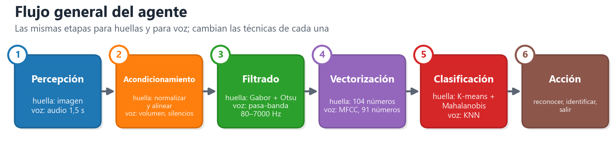

---

## 1.2 Método 1: K-means y distancia de Mahalanobis para las huellas dactilares

### a) Datos de partida

- Las huellas se crearon **sintéticamente con el software Anguli**. Se generaron **3 identidades base** (huellas maestras) de **clases de huella distintas**: la identidad 1 es un *lazo a la izquierda* (Left Loop), la identidad 2 una *espiral* (Whorl) y la identidad 3 un *arco* (Arch). Se eligieron de clases distintas para que los patrones de crestas no se parezcan.
- A cada identidad se le generaron **55 impresiones** con **distorsiones propias de la aplicación** (giro, traslación, rayones y ruido): 5 impresiones “primera” (giro hasta 30°, traslación hasta 16 px, rayones y ruido hasta 20), 25 con filtro **débil** y 25 con filtro **medio**. En total son **165 huellas autorizadas**.
- Además se generaron **50 intrusos**: huellas maestras de personas nuevas, que el sistema no conoce.
- *Limitación:* como son filtros nativos de la aplicación, **no se asegura que se parezcan a lo que pasaría con huellas reales** (piel seca, sensores distintos, presión, etc.).

**Partición de los datos.** Las huellas autorizadas se reparten dentro de cada identidad y de cada nivel de filtro: **60 % entrenamiento (99 huellas), 20 % validación (33) y 20 % prueba (33)**. Los intrusos se dividen en **25 de calibración** (sirven para fijar el umbral) y **25 de prueba** (solo se usan para evaluar).

### b) Acondicionamiento de las imágenes

Se aplica **el mismo proceso a cualquier imagen**, sin saber qué distorsión trae. Pasos:

1. **Normalización del contraste:** se estira el rango de grises para que las crestas se vean con más contraste.
2. **Máscara de la zona con crestas:** se separa la huella del fondo blanco para trabajar solo con la parte útil.
3. **Alineación (rotar y trasladar):** se centra la huella en el cuadro y se la gira hasta dejarla vertical, para que una huella desplazada o girada se parezca a su original.

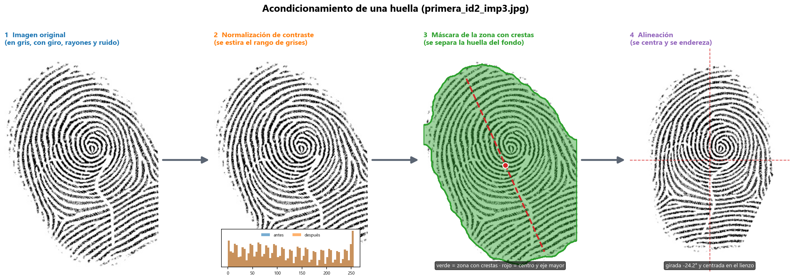

### c) Filtrado

- **Filtro de Gabor orientado.** Una huella es un patrón de líneas (crestas) que van cambiando de dirección. El filtro de Gabor es un “detector de rayas”: primero se estima **hacia dónde apuntan las crestas en cada zona** y **cada cuánto se repiten**; después, en cada zona, se aplica un filtro sintonizado a esa dirección. El resultado **refuerza las crestas, rellena cortes y rayones que siguen la dirección de la cresta y elimina el ruido**.
- **Binarización (método de Otsu).** Convierte la imagen de grises en **solo blanco y negro**: el algoritmo elige solo el umbral que mejor separa los píxeles claros de los oscuros; lo oscuro (la cresta) queda **negro** y lo demás **blanco**. Después se limpian las motas sueltas. Así las crestas quedan nítidas para medirlas.

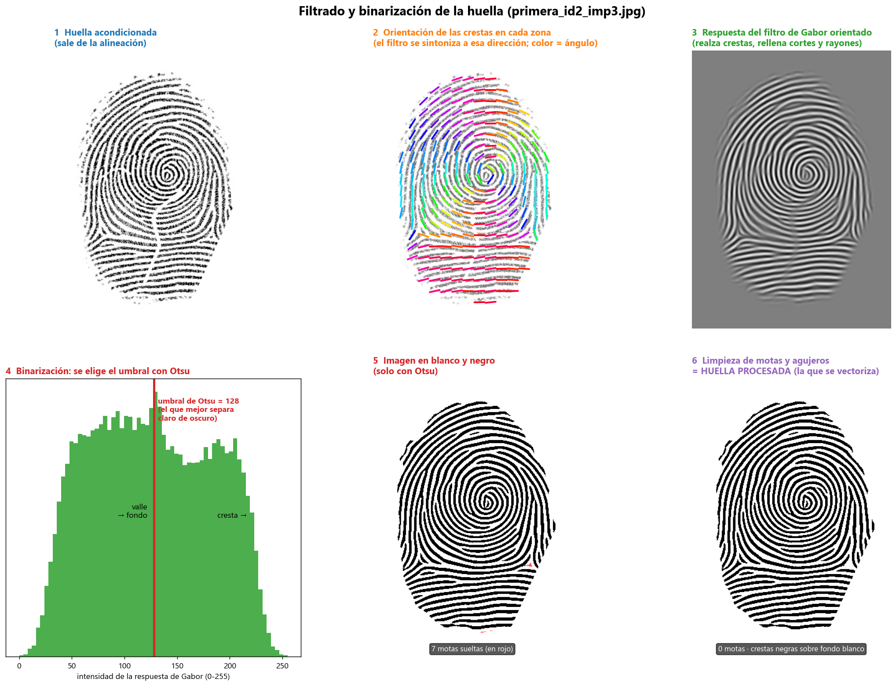

### d) Vectorización (extracción de características)

Una imagen no se puede comparar directamente; hay que resumirla en una **lista de números de largo fijo** (un *vector*). Aquí el vector tiene **104 números**, que se obtienen de dos bloques sobre la huella ya procesada:

**Bloque A: orientación de las crestas (72 números).** Se calcula el ángulo de las crestas en cada punto de la huella y se arman **histogramas** que cuentan cuánta huella hay con cada inclinación:

- **24 números:** histograma de **toda** la huella. Los ángulos de 0° a 180° se dividen en 24 rangos de 7,5°; cada número dice **qué fracción de la huella** tiene crestas con esa orientación.
- **4 × 12 = 48 números:** la huella se divide en **4 cuadrantes** (arriba-izquierda, arriba-derecha, abajo-izquierda, abajo-derecha) y en cada uno se arma un histograma de **12 rangos** de 15°. Agrega **dónde** están las orientaciones, no solo cuáles hay.

**Bloque B: energía de Gabor (32 números).** Se aplican **8 filtros de Gabor** orientados (0°, 22,5°, … 157,5°) y se mide cuánta energía responde cada uno en cada uno de los **4 cuadrantes**: 4 × 8 = 32 números. Dicen qué tan marcadas están las crestas en cada dirección y en cada zona.

> Total: 72 + 32 = **104 números por huella**.
> 

**Normalización.** Cada una de las 104 columnas se normaliza: se le resta la **media** y se divide por el **desvío** de esa columna (calculados solo con las huellas de entrenamiento). Así ningún número pesa más que otro por tener una escala mayor.

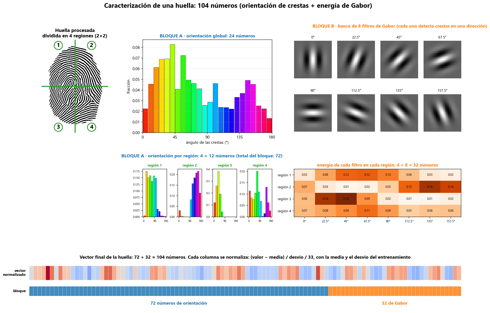

### e) Aplicación de K-means

**K-means** agrupa vectores parecidos en **clusters** (grupos), cada uno con un **centroide** (el “centro” del grupo, el promedio de sus vectores; es un punto nuevo, no una huella real). **No usa las etiquetas** (no sabe de quién es cada huella): agrupa solo por parecido, midiendo la **distancia euclídea** entre los vectores de 104 números.

**Elección de K:** K es la cantidad de grupos. Se usa **K = 3**, porque hay **3 identidades autorizadas** (un cluster por persona).

Una vez que tenemos los vectores, se realizan **5 pasos** (solo con las **99 huellas de entrenamiento**):

| Paso | Qué se hace |
| --- | --- |
| **1. Inicializar** | Se eligen **K = 3 huellas al azar** como centroides iniciales |
| **2. Asignar** | Cada huella se asigna al **centroide más cercano** (distancia euclídea) |
| **3. Recalcular** | Cada centroide se mueve al **promedio** de las huellas de su grupo |
| **4. Reasignar** | Se repiten los pasos 2 y 3 hasta que **ninguna huella cambie de grupo** (el algoritmo *convergió*) |
| **5. Repetir** | Como el resultado depende del azar inicial, todo se repite **10 veces** con centroides iniciales distintos y se **conserva la mejor corrida** (la de menor *inercia*: suma de distancias al cuadrado de cada huella a su centroide) |

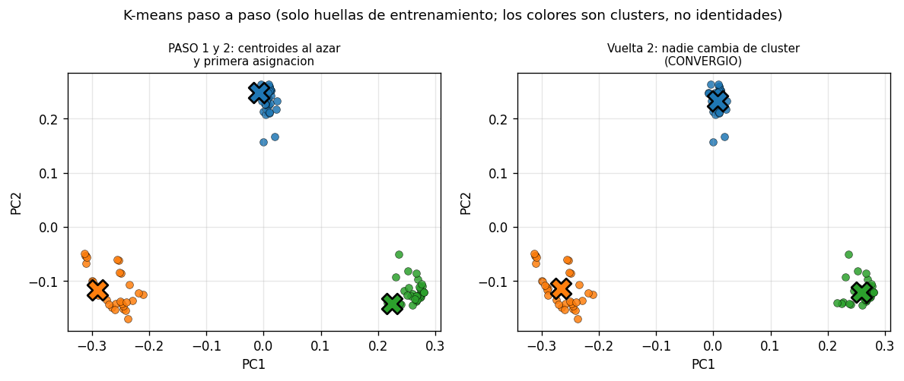

### f) De cluster a identidad (algoritmo húngaro)

K-means devuelve clusters numerados 0, 1, 2 **sin saber a quién corresponde cada uno**. Para ponerles nombre se usa el entrenamiento, donde sí se conoce la identidad real de cada huella: se **cuenta cuántas huellas de cada identidad cayeron en cada cluster** y se hace una **asignación uno a uno** que maximiza los aciertos.

- **Algoritmo húngaro:** resuelve el problema de emparejar elementos de dos grupos (acá, clusters con identidades) **sin repetir ninguno** y de modo que el **total de aciertos sea el mayor posible**. Evita, por ejemplo, que dos clusters terminen con la misma identidad.

### g) Regla de decisión: distancia de Mahalanobis y umbral de rechazo

Hace falta poder decir **“NO AUTORIZADO”**: una huella que no se parece a ninguna de las 3 personas no debe aceptarse. Para eso se define una **distancia de la huella a cada identidad** y un **umbral**.

**Por qué no alcanza con la distancia euclídea.** La distancia euclídea trata todas las direcciones por igual, así que su zona de aceptación es una **esfera** alrededor del centroide. Pero las huellas de una misma persona no varían igual en todas las direcciones: las distorsiones (giro, desplazamiento, ruido) estiran la nube de esa persona más hacia unas direcciones que hacia otras. La **distancia de Mahalanobis** tiene en cuenta esa forma: mide **cuántas desviaciones** se aparta la huella del centro de la identidad en cada dirección. Su zona de aceptación es un **elipsoide**, alargado donde la identidad varía mucho y angosto donde varía poco.

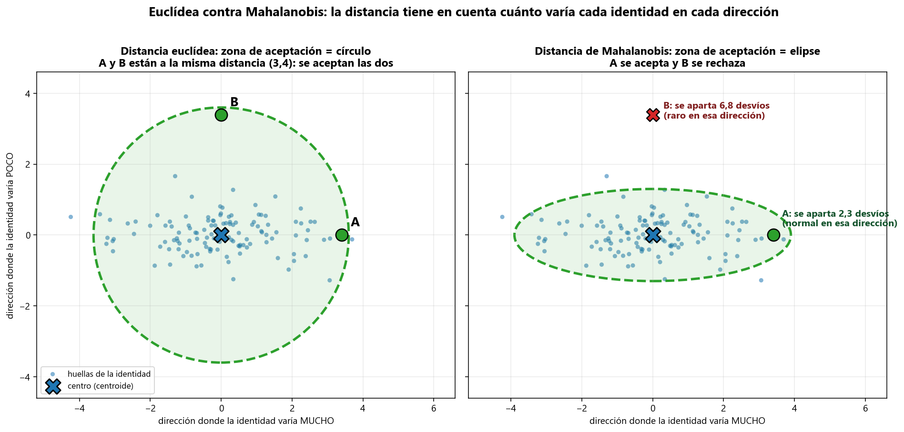

**Cómo se calcula.** Primero se **comprimen** los 104 números con un **PCA** a **6 componentes** (las 6 direcciones en las que las huellas más se diferencian, que explican el 90,4 % de la variación). Luego, para cada identidad:

$$
T^2 = (\mathbf{x} - \mathbf{c})^{T}\, \Sigma^{-1}\, (\mathbf{x} - \mathbf{c})
$$

- $\mathbf{x}$: la huella evaluada, expresada en las 6 componentes del PCA.
- $\mathbf{c}$: el centro de la identidad en esas 6 componentes (el promedio de sus huellas de entrenamiento).
- $\Sigma$: la **covarianza** de esa identidad (tabla de 6 × 6 que dice cuánto varían sus huellas en cada componente y cómo varían juntas).
- $\Sigma^{-1}$: su inversa. Es lo que da el **peso** de cada dirección: donde la identidad varía mucho, el peso es chico (alejarse ahí es normal y cuenta poco); donde varía poco, el peso es grande (alejarse ahí es raro y cuenta mucho).
- $T^2$ (estadístico de Hotelling): la distancia de Mahalanobis al cuadrado. Cuanto más chico, más se parece la huella a esa identidad.

El PCA y las covarianzas se calculan **después** de K-means y solo con las huellas de entrenamiento, porque hacen falta los grupos ya formados. Por eso K-means usa la distancia euclídea (no necesita grupos) y la decisión usa Mahalanobis. Para estabilizar la covarianza (hay unas 33 huellas por identidad) se la mezcla en un 30 % con la covarianza conjunta de las tres identidades.

**Cómo se calcula el umbral.** Se hace en dos pasos:

1. **Límite de lo normal.** Se toman las **33 huellas autorizadas de validación** (impresiones nuevas de las mismas personas que no se usaron para entrenar) y se calcula el $T^2$ de cada una a su identidad más cercana. El **percentil 95** de esos valores (el valor que deja por debajo al 95 % de ellas) es el **límite = 9,16**.
2. **Umbral $\lambda$.** Se calcula el $T^2$ de cada **intruso de calibración** (25 huellas) dividido por ese límite. El menor valor, que corresponde al intruso más parecido a una identidad, es **1,48**. Ese es $\lambda$: el **mayor valor con el que ningún intruso de calibración queda aceptado**.

El umbral, expresado en $T^2$, es **1,48 × 9,16 = 13,6**. Que $\lambda$ sea mayor que 1 significa que se tolera hasta 1,48 veces el límite de lo normal: se aceptan autorizadas algo más alejadas que el 95 % típico y todavía queda afuera el intruso más cercano. $\lambda$ **no es un porcentaje de parecido**, sino un múltiplo del límite.

Hay dos errores posibles, que se miden así:

- Una persona **autorizada** es rechazada. Un umbral chico aumenta este error.
- Un **intruso** es aceptado. Un umbral grande aumenta este error.

El criterio es **conservador**: prioriza no dejar entrar a ningún intruso. Los otros 25 intrusos (de prueba) no intervienen en elegir $\lambda$ y dan la medida honesta de cuántos intrusos entran.

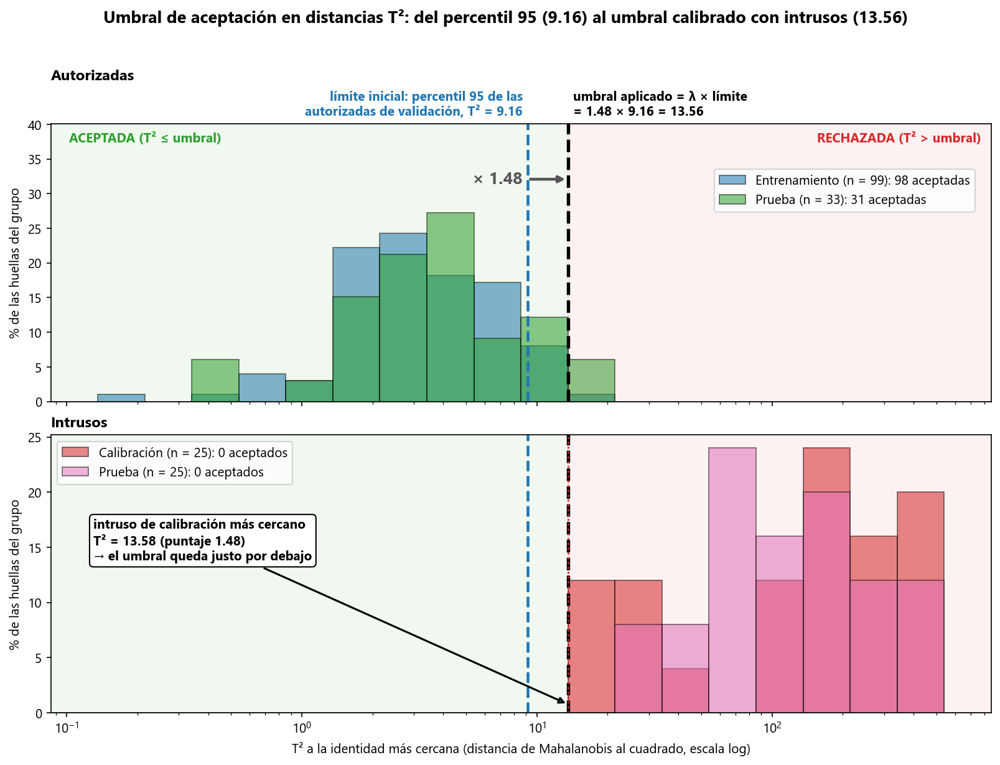

**Cómo se ve el umbral en distancias $T^2$.** Cada rectángulo es un intervalo de $T^2$ y su altura es el porcentaje de las huellas del grupo que cae ahí. Arriba están las autorizadas (entrenamiento y prueba); abajo, los intrusos (calibración y prueba). La **línea azul** es el límite de lo normal (percentil 95 de la validación, $T^2$ = 9,16) y la **línea negra** es el umbral aplicado (1,48 × 9,16 = 13,56); la flecha muestra cuánto se movió la línea al calibrarla con intrusos. A la izquierda del umbral (verde) se acepta y a la derecha (rojo) se rechaza. Los intrusos de calibración y de prueba quedan **todos** del lado rechazado; el más cercano ($T^2$ = 13,58) queda justo por encima, y por eso es el que fija el valor de $\lambda$.

*Nota:* el código también calcula el **residuo Q** (lo que las 6 componentes no explican) y lo muestra en los gráficos, pero **no interviene en la decisión**.

**Comparación con la distancia euclídea.** Con este dataset se probó aplicar la misma idea con la distancia euclídea (un solo umbral sobre la distancia al centroide, elegido con el mismo criterio):

| Regla | Autorizadas rechazadas (validación y prueba) | Autorizadas rechazadas (prueba) | Intrusos de prueba aceptados |
| --- | --- | --- | --- |
| Euclídea (R = 0,228) | 4,5 % | 6,1 % | 0 de 25 |
| **Mahalanobis (T² ≤ 13,6)** | **3,0 %** | 6,1 % | 0 de 25 |

Con identidades bien separadas, las dos reglas dan resultados casi iguales; Mahalanobis rechaza menos autorizadas.

### h) Regla de decisión para una huella nueva

Implementada en `identificar_huella()`:

1. Acondicionar la huella, calcular sus 104 números, normalizarlos y proyectarlos a las 6 componentes del PCA.
2. Calcular el $T^2$ de Mahalanobis a cada una de las 3 identidades y quedarse con la **de menor $T^2$** (la identidad más cercana).
3. Si $T^2 \le 13{,}6$ (es decir, puntaje $\le \lambda = 1{,}48$) → se **acepta** con esa identidad.
4. Si es **mayor** → **“NO AUTORIZADO”**.

$$
j = \arg\min_k\, T^2_k(\mathbf{x}) \qquad
\text{Decisión} = \begin{cases}\text{identidad } j & T^2_j(\mathbf{x}) \le \lambda\cdot L_{T^2} = 13{,}6 \\ \text{NO AUTORIZADO} & T^2_j(\mathbf{x}) > 13{,}6\end{cases}
$$

- $T^2_k(\mathbf{x})$: distancia de Mahalanobis al cuadrado de la huella a la identidad $k$ ($k = 1, 2, 3$).
- $L_{T^2}$: límite de lo normal (percentil 95 de la validación, 9,16).
- $\lambda$: umbral (1,48), calibrado con intrusos.

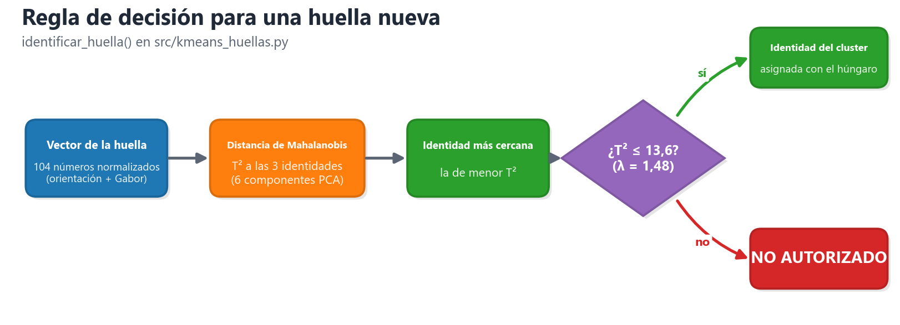

---

## 1.3 Método 2: KNN para los comandos de voz

### a) Obtención de los datos

Se tomaron muestras de voz de **8 sesiones de grabación (personas o condiciones distintas)** **[7 personas]**, con un total de **197 muestras** para los 3 comandos (*reconocer* 60, *identificar* 76, *salir* 61). Todas se grabaron **con el mismo micrófono**, con un **script de Python** que toma audios de **1,5 segundos** (16 kHz, mono). Se usó el mismo micrófono que se usa en la demo para que las diferencias entre audios se deban a la palabra y no al equipo.

### b) Acondicionamiento

Cada audio crudo se deja “en condiciones” antes de analizarlo:

1. **Quitar la componente continua:** se resta el promedio de la señal, para que el audio oscile alrededor de cero (sin “desplazamiento” por el micrófono).
2. **Recorte de silencios por energía:** se mide la energía en tramos cortos y se **descarta lo que no es voz** (el silencio del principio y del final), dejando 100 ms de margen. Así el silencio no influye en la comparación.
3. **Normalización de volumen:** se lleva el volumen de la voz a un nivel fijo (**RMS a −20 dBFS**: el RMS es el volumen promedio), con un **limitador de pico** que evita que el audio sature. Así un audio grabado más cerca o más lejos del micrófono queda comparable.

### c) Filtrado

**Filtro pasa-banda Butterworth de 80 a 7000 Hz, de fase cero:** deja pasar solo las frecuencias entre 80 y 7000 Hz, que es donde está la voz. **Elimina zumbidos graves** (por ejemplo el de la corriente eléctrica) **y ruido muy agudo**. Es “de fase cero” porque se aplica una vez hacia adelante y otra hacia atrás, de modo que **no desplaza el sonido en el tiempo**.

### d) Caracterización (de la señal a números)

Un audio no se puede comparar directamente (son miles de valores y dos personas nunca dicen la palabra igual). Se lo convierte en números que describen **cómo suena** (el timbre). Pasos, que dan los llamados **MFCC**:

| Paso | Qué hace (breve) |
| --- | --- |
| **Pre-énfasis** | Refuerza un poco los sonidos agudos, que en la voz son más débiles, para que no queden tapados por los graves |
| **Ventanas de 25 ms** | La voz cambia muy rápido, así que se la corta en **tramos de 25 ms, uno cada 10 ms** (superpuestos), y en cada tramo se suavizan los bordes (ventana de Hamming) |
| **FFT** | Calcula **qué frecuencias** (graves/agudos) hay en cada tramo y con qué fuerza |
| **40 filtros Mel** | Agrupa las frecuencias en **40 bandas** siguiendo la escala Mel, que imita al oído humano (distingue mucho entre graves y poco entre agudos) |
| **Logaritmo** | Comprime la energía de cada banda, como percibe el volumen el oído |
| **DCT** | Resume las 40 energías en **unos pocos números** que no se repiten información entre sí: son los **13 MFCC** (sin el primero, que es el volumen) y describen la **forma del tracto vocal**: el timbre del sonido |
| **Δ (delta)** | **Velocidad de cambio** de cada MFCC de un tramo al siguiente: cómo se mueve la boca |
| **ΔΔ (delta-delta)** | **Aceleración**: cuánto cambia esa velocidad |

**Qué es “un tramo”.** Cada tramo es un pedacito del audio (cada 10 ms). De cada uno salen 13 MFCC + 13 Δ + 13 ΔΔ = **39 números por tramo**. Como cada audio dura distinto, queda una **matriz de tramos × 39** (un audio de 1 s tiene unos 90 tramos).

**Vector de largo fijo de 91 números.** Para comparar audios de distinta duración con la distancia euclídea hace falta un vector del mismo largo para todos: **91 = 4 × 13 + 39** → la **media de los 13 MFCC en cada cuarto** del audio (52 números, conserva algo del orden en el tiempo) más el **desvío de cada uno de los 39 coeficientes** (cuánto varía a lo largo del audio).

*Por qué 13 MFCC:* es el tamaño estándar en reconocimiento de voz; alcanza para describir el timbre y más coeficientes agregan solo detalle fino y ruido. *Por qué 91:* con K = 3 y dejando afuera una persona entera en cada prueba, la media de los 13 MFCC acierta 50 %; media + desvío, 69 %; y **4 cuartos + desvío (los 91), 87 %**.

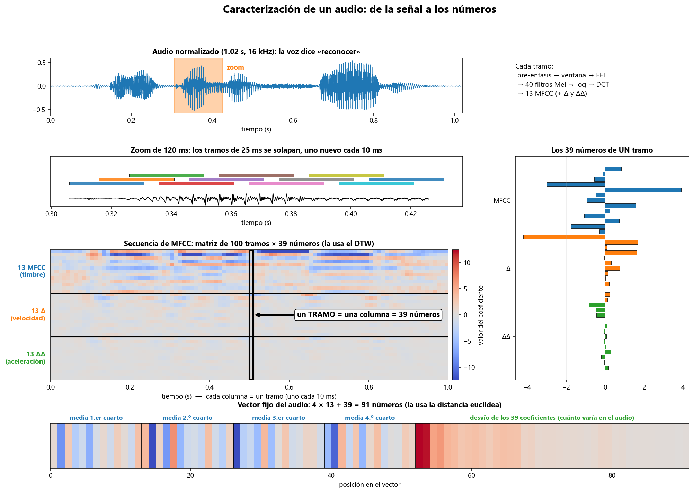

### e) Distancia entre audios: euclídea

Cada audio queda representado por su vector de 91 números, y dos audios se comparan con la **distancia euclídea**: se calcula la diferencia en cada una de las 91 componentes, se eleva al cuadrado, se suman y se saca la raíz.

$$
d(\mathbf{a}, \mathbf{b}) = \sqrt{\sum_{i=1}^{91} (a_i - b_i)^2}
$$

- $\mathbf{a}$, $\mathbf{b}$: los vectores de 91 números de los dos audios.
- $a_i$, $b_i$: la componente $i$ de cada uno.

Antes de calcularla, cada componente se **estandariza** (se resta la media y se divide por el desvío, calculados solo con el entrenamiento), porque los MFCC y sus desvíos tienen escalas distintas y las más grandes dominarían la distancia. Cuanto menor es la distancia, más parecidos son los audios.

*A diferencia de las huellas,* en la voz se usa la distancia euclídea y no la de Mahalanobis: el KNN no forma grupos con centro y covarianza propios, sino que compara cada audio nuevo con **todos** los ejemplos de entrenamiento.

### f) Aplicación: KNN (K vecinos más cercanos)

**KNN no “aprende” una fórmula:** guarda los ejemplos de entrenamiento y, para clasificar uno nuevo, **mira a quiénes se parece más y copia lo que ellos son**. Es como preguntarle a los K vecinos más parecidos: **gana la clase que más se repite**.

**Se separa el dataset en 3 conjuntos, por persona (no al azar)**, para que ninguna persona esté en dos conjuntos a la vez:

| Conjunto | Para qué sirve | En este proyecto |
| --- | --- | --- |
| **Entrenamiento** | Ejemplos de referencia: vectores **con su comando conocido**. Contra ellos se compara | 137 audios (sesiones normal, giuli, mo, ruido) |
| **Validación** | Se clasifican como si fueran nuevos para **elegir K**. El modelo no los usó para “aprender” | 38 audios (mama, joaco) |
| **Prueba** | Se usa **una sola vez, al final**, para medir qué tan bien funciona con datos totalmente nuevos | 22 audios (maxi, mili) |

**Qué se hace y qué se obtiene en cada etapa:**

| Etapa | Qué se hace y cómo | Qué se obtiene |
| --- | --- | --- |
| **1. Entrenamiento** | Se guarda la referencia: el vector de 91 números de cada audio con su comando (y la media y el desvío de cada número, calculados **solo** con estos datos para no “filtrar” información de la prueba) | La **base de ejemplos** contra la que se compara. No hay entrenamiento propiamente dicho |
| **2. Validación** | Para **cada audio de validación** se calcula la **distancia euclídea a los 137 de referencia**, se toman los **K más cercanos** y se elige el **comando más votado**. Esto se repite para K = 1, 3, 5, …, 15 | Una **tabla de exactitud** por K. Se elige la mejor: **K = 3** (94,7 % en validación) |
| **3. Prueba** | Con K = 3, se clasifican los audios de prueba **una sola vez**, tomando como referencia **entrenamiento + validación** | La **medida honesta** del sistema: **90,9 %** de aciertos (20 de 22), con su matriz de confusión |

**¿Cómo se elige K?** Se prueban los K impares de 1 a 15 (los impares evitan empates) y se mide cuántos audios de validación acierta cada K, **nunca con la prueba**. Se queda el K con mayor exactitud; si empatan, el más chico. K = 1 es el peor porque depende de un solo vecino y se equivoca con un audio raro.

| Distancia | K=1 | K=3 | K=5 | K=7 | K=9 | K=11 | K=13 | K=15 |
| --- | --- | --- | --- | --- | --- | --- | --- | --- |
| Euclídea | 81,6 % | **94,7 %** | 92,1 % | 92,1 % | 92,1 % | 92,1 % | 92,1 % | 94,7 % |

### g) ¿Qué se hace con un audio nuevo?

**Se calcula la distancia euclídea a todos los audios de referencia, se toman los 3 más cercanos y gana el comando más votado.** En detalle:

1. Se **acondiciona y filtra** el audio igual que los del dataset (quitar continua, pasa-banda, recorte de silencios, volumen).
2. Se **caracteriza**: se calculan sus MFCC y se resume en el vector de 91 números, estandarizado.
3. Se calcula la **distancia euclídea** contra **cada uno de los audios de referencia** (en el sistema final la referencia son todos los 197 audios).
4. Se ordenan de menor a mayor y se toman los **K = 3 más cercanos** (los vecinos).
5. **Votación:** cada vecino vota por su comando; **gana el comando con más votos**. Si hay empate, gana el del vecino más cercano.
6. El sistema responde con el comando y una **confianza**: *alta* si los 3 vecinos coinciden, *media* si ganó 2 contra 1.

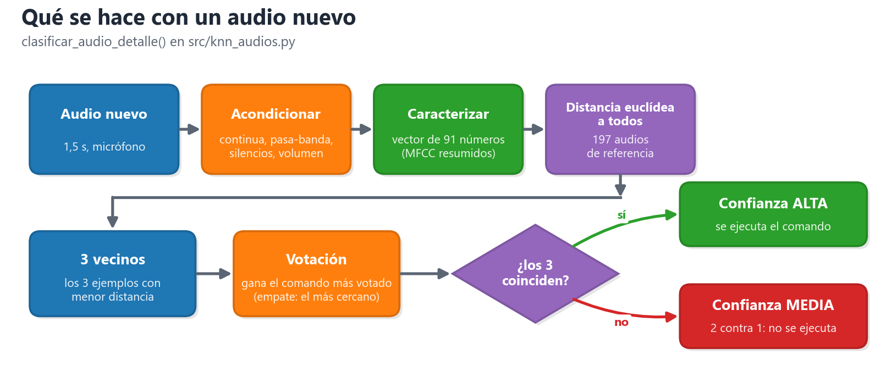

*Limitación:* el KNN **siempre elige uno de los 3 comandos**, aunque se diga otra palabra o haya ruido (no existe una clase “otros”). Por eso la interfaz solo ejecuta un comando cuando la confianza es alta.

# 1.4 Ejemplo de aplicación

**Huella de una persona autorizada.** Se elige “Identidad 1” y un filtro (débil o medio) y se genera la huella con Anguli. A la izquierda se ve la huella generada y a la derecha la huella ya procesada.

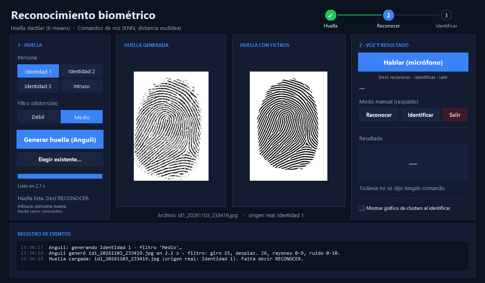

Genera una huella

**Comando “reconocer”.** Dicho por voz, el sistema evalúa la huella y responde si es una persona autorizada.

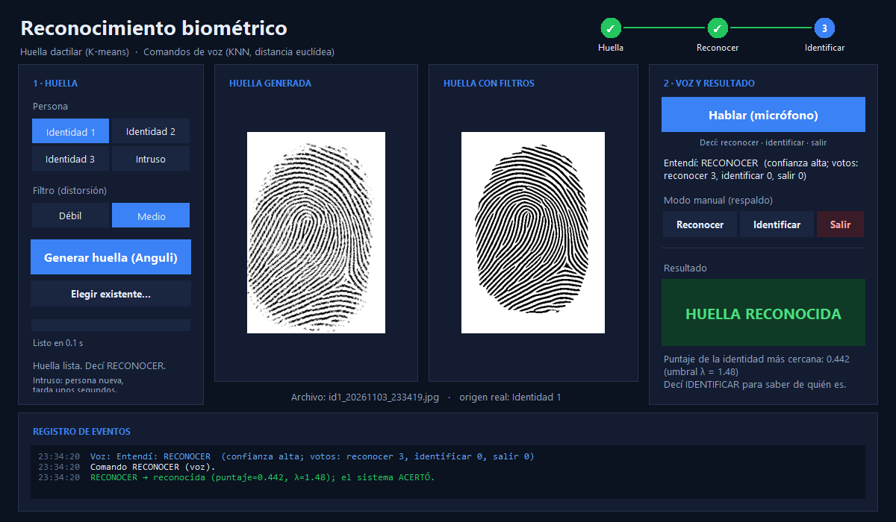

Reconoce Huella

**Comando “identificar”.** Si la huella fue reconocida, el sistema indica a qué identidad pertenece, con su puntaje (0,44) y el umbral ($\lambda$ = 1,48).

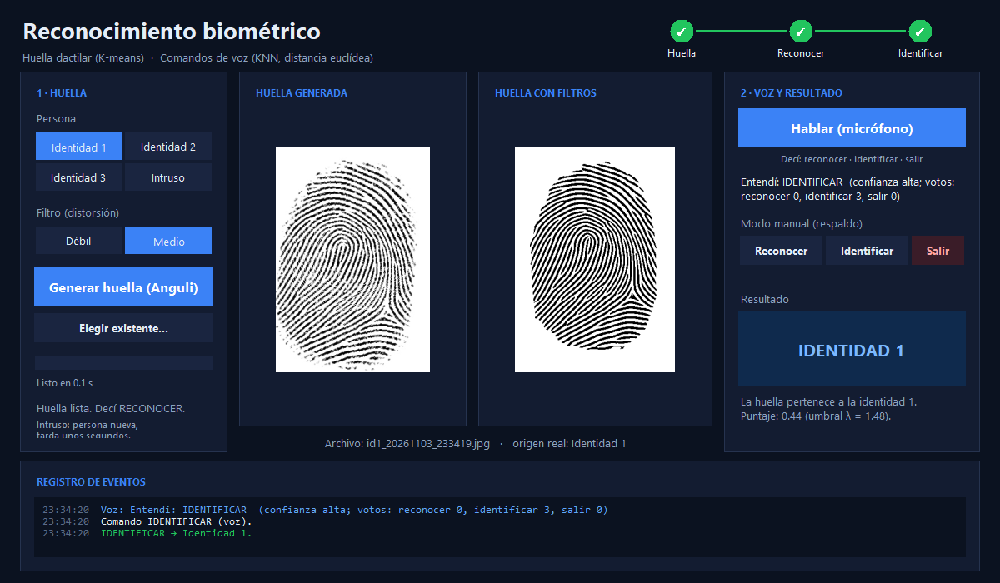

Identifica huella

**Gráfico de clusters** (opcional). Muestra, en el plano PC1-PC2, dónde cayó la huella nueva (estrella) respecto de la elipse de aceptación de cada identidad. No se abre solo: se pide con el botón “Ver gráfico de clusters”.

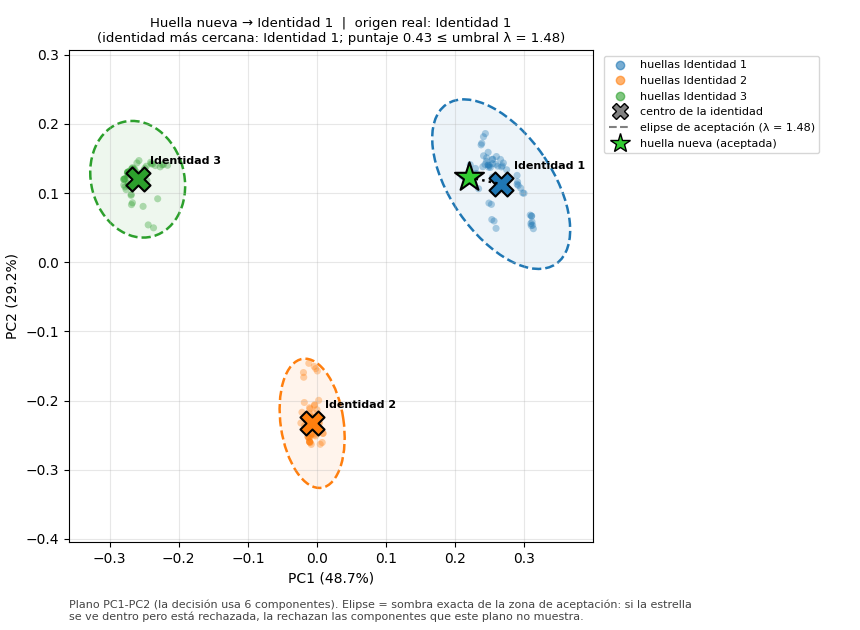

**Ejemplo con un intruso.** Se genera la huella de una persona nueva y se dice “reconocer”: el sistema responde **NO RECONOCIDA (no autorizada)**, porque su puntaje (28,3) supera ampliamente el umbral (1,48).

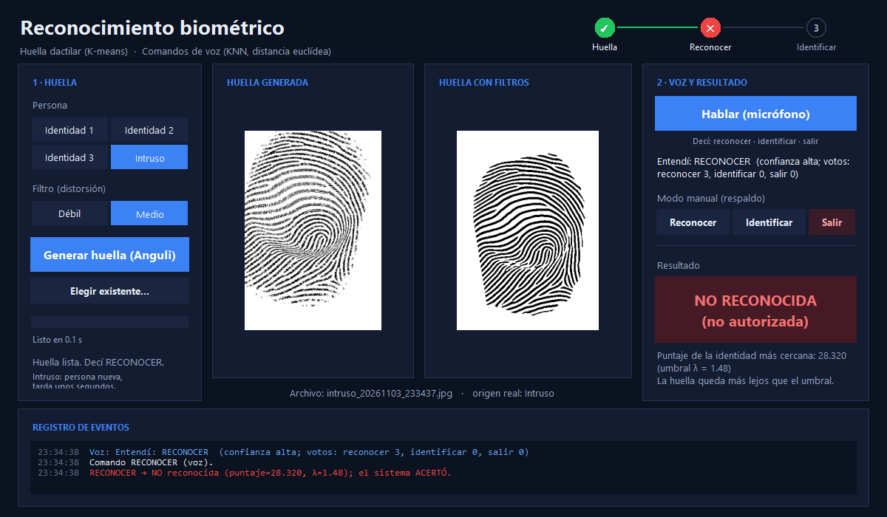

---

# <u>2. Código: descripción general</u>

## 2.1 Descripción general del código

El proyecto está hecho en **Python** (NumPy, OpenCV, SciPy, Matplotlib y Tkinter; scikit-learn solo para el PCA de los gráficos y para verificar). Cada etapa es un **script independiente** que se ejecuta por separado y deja su resultado en una carpeta; el siguiente script lee esa carpeta. Todos son **incrementales** (al volver a correrlos solo procesan lo nuevo) y **nunca modifican los datos originales**.

Se explican en el **orden en que se fueron creando**, que coincide con las etapas del agente. Solo se detallan los puntos conceptuales importantes de cada algoritmo.

| Etapa | Script | Qué hace |
| --- | --- | --- |
| Datos de huellas | `generar_identidades_base.py`, `generar_dataset_huellas.py` | Generan con Anguli las 3 identidades base, sus 55 impresiones y los 50 intrusos |
| Acondicionamiento | `preprocesar.py`, `normalizar_audios.py` | Dejan las huellas (contraste, alineación, Gabor, Otsu) y los audios (filtro, silencios, volumen) en condiciones |
| Caracterización | `caracterizar_huellas.py`, `caracterizar_audios.py` | Convierten cada huella en 104 números y cada audio en MFCC y un vector de 91 números |
| Partición | `particion_huellas.py` | Separa las huellas en entrenamiento, validación y prueba, y los intrusos en calibración y prueba |
| Clasificación de huellas | `kmeans_huellas.py`, `decision_huellas.py` | K-means desde cero y regla de decisión (PCA, Mahalanobis, límite y umbral) |
| Clasificación de voz | `knn_audios.py` | KNN desde cero con distancia euclídea |
| Apoyo | `metricas.py`, `graficar_pca.py`, `probar_huellas.py`, `probar_voz.py` | Matrices de confusión, gráficos y pruebas con huellas y voces nuevas |

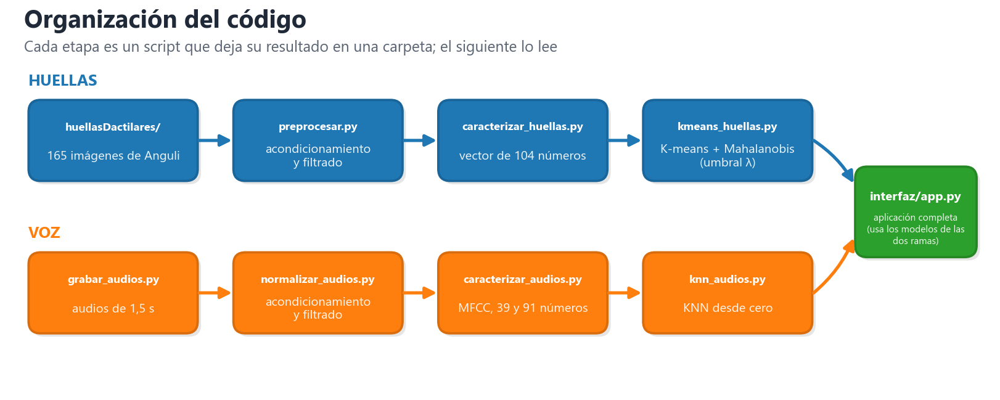

### Interfaz

La interfaz **no reimplementa ningún algoritmo**: reutiliza los módulos de `src/`.

**Funcionamiento básico.** Ventana de escritorio (Tkinter) en tres zonas: a la izquierda se elige la persona (identidad 1, 2, 3 o intruso) y el filtro (débil o medio, los niveles con los que se entrenó el sistema) y se genera la huella; en el centro se ven la huella generada y la procesada; a la derecha se usa el micrófono y se ve el resultado. Abajo hay un registro de eventos, y arriba un indicador de pasos (Huella → Reconocer → Identificar). El trabajo pesado corre en hilos para que la ventana no se congele, y una barra de progreso muestra el tiempo estimado que queda.

**Flujo de trabajo y conexión con los otros programas:**

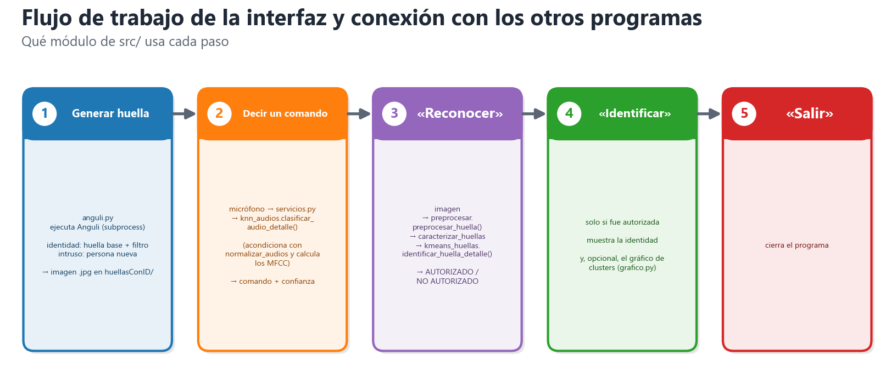

| Archivo | Función |
| --- | --- |
| `app.py` | Ventana, hilos y flujo de pasos |
| `estilo.py` | Aspecto visual (tema oscuro, botones, indicador de pasos) |
| `anguli.py` | Llama a Anguli por línea de comandos y define los filtros débil y medio |
| `servicios.py` | Lógica sin ventana: conecta voz y huella con los modelos de `src/` |
| `grafico.py` | Gráfico de clusters con la huella evaluada (elipses de aceptación y puntaje) |
| `config.py` | Rutas, micrófono y opciones |

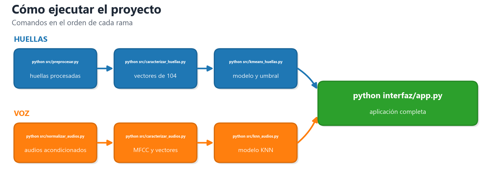

---

# <u>3. Resultados</u>

## 3.1 Datos utilizados

**Huellas (sintéticas, generadas con Anguli).** 3 identidades autorizadas (3 huellas maestras de clases distintas: Left Loop, Whorl y Arch) con 55 impresiones cada una (5 “primera”, 25 débil y 25 medio): **165 imágenes**. Se reparten en **entrenamiento (99), validación (33) y prueba (33)**. Además, **50 intrusos** (maestras nuevas de otras personas): 25 para calibrar el umbral y 25 para evaluar. Para probar la interfaz se generaron además 30 autorizadas y 8 intrusos adicionales, con el mismo generador.

**Voz (grabada).** **197 audios** de 1,5 s (16 kHz, mono) con el mismo micrófono: *reconocer* 60, *identificar* 76 y *salir* 61, en 8 sesiones. Separados **por persona** (nunca al azar) en entrenamiento (137), validación (38) y prueba (22).

## 3.2 Generación de datos sintéticos

Las huellas se generaron con el software **Anguli**: primero 3 **patrones base** distintos (huellas maestras, de clases Left Loop, Whorl y Arch) y luego, para cada identidad, **variantes** aplicando las transformaciones propias del programa: rotación, traslación, rayones y ruido. Los niveles de distorsión son:

| Nivel | Giro máximo | Traslación máxima | Rayones (máx.) | Ruido (máx.) | Impresiones por identidad |
| --- | --- | --- | --- | --- | --- |
| `primera` | 30° | 16 px | hasta 20 | hasta 20 | 5 |
| Débil | 3° a 7° | 6 a 14 px | 1 a 3 | 2 a 4 | 25 |
| Medio | 12° a 18° | 25 a 35 px | 6 a 10 | 6 a 10 | 25 |

Los intrusos se generan como huellas maestras nuevas (otra persona, sin la identidad de ninguna de las tres). Cada impresión es una distorsión nueva de la huella maestra. En la interfaz solo se ofrecen los niveles débil y medio, que son con los que se entrenó el sistema. *Limitación:* son filtros nativos de Anguli; no se asegura que se parezcan a las distorsiones de huellas reales.

## 3.3 Estadísticas de la clasificación - Matrices de confusión

### <u>**Huellas: K-means + Mahalanobis**</u>

#### Matriz de confusión de la prueba (fila = real, columna = predicho):

La matriz es la de la **prueba con intrusos**: tiene una cuarta columna y una cuarta fila, “NO AUTORIZADO” e “Intruso”, y usa las **33 autorizadas de prueba** más los **25 intrusos de prueba** (58 huellas que no se usaron ni para entrenar ni para calibrar). Se acertaron **56 de 58 (96,6 %)**: las 2 únicas fallas son autorizadas rechazadas por error (una de la identidad 1 y una de la 2); ninguna se confundió con otra identidad y ningún intruso fue aceptado.

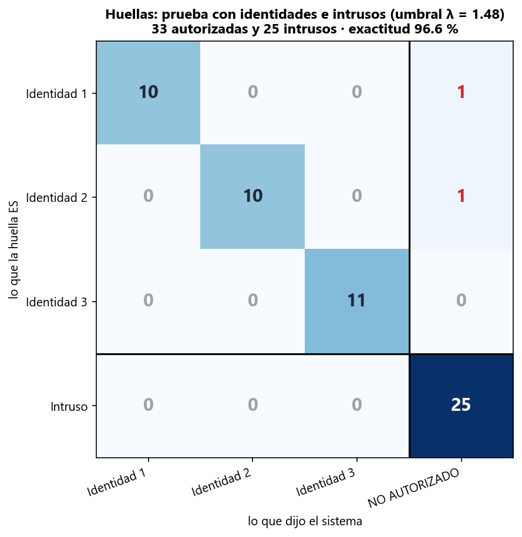

La **identificación** (a qué identidad pertenece una autorizada) fue correcta en las tres etapas; lo que cambia es cuántas autorizadas rechaza el umbral:

| Etapa | Huellas | Exactitud de identificación | Autorizadas rechazadas (con el umbral) |
| --- | --- | --- | --- |
| Entrenamiento | 99 | 100 % | 1,0 % (1 de 99) |
| Validación | 33 | 100 % | 0 % (0 de 33) |
| **Prueba** | 33 | **100 %** | **6,1 %** (2 de 33) |

$$
\text{Exactitud} = \frac{\sum_{i} M_{ii}}{N}
$$

- $M_{ii}$: elementos de la diagonal de la matriz de confusión (muestras bien clasificadas de la clase $i$).
- $N$: cantidad total de muestras evaluadas.

**Umbral de rechazo ($\lambda$ = 1,48; T² ≤ 13,6).**

| Conjunto de intrusos | Intrusos aceptados |
| --- | --- |
| Calibración (25) | 0 % (0 de 25) |
| **Prueba (25)** | **0 %** (0 de 25) |

El gráfico del umbral del apartado 1.2 g muestra el mismo resultado: las autorizadas se concentran por debajo del umbral y los intrusos, tanto los de calibración como los de prueba, quedan todos por encima.

**Prueba con la interfaz.** Con 38 huellas nuevas generadas por la interfaz (30 autorizadas y 8 intrusos, con filtros débil y medio) se obtuvo un acierto de **38 de 38**: las 30 autorizadas se identificaron bien y los 8 intrusos se rechazaron. *Limitación:* con el nivel **fuerte** (giro de 30° y traslación de 60 px a la vez), que no se usó para entrenar, el sistema rechazó a 12 de 15 autorizadas (y no aceptó a ningún intruso).

### <u>Voz: KNN con distancia euclídea (K = 3)</u>

#### Matrices de confusión de validación y prueba (fila = real, columna = predicho):

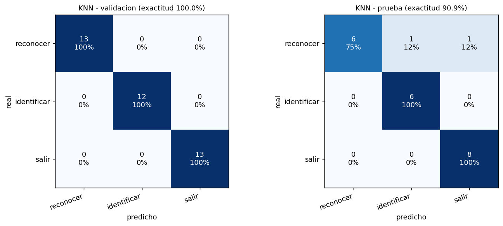

En etapa de validación se utilizan 38 audios y en prueba 22 audios.

|  | Validación (38) | Prueba (22) |
| --- | --- | --- |
| Exactitud | 94,7 % (36 de 38) | **90,9 %** (20 de 22) |
| F1 promedio | 0,947 | 0,908 |

Los errores de la prueba son dos audios de personas nuevas: uno de *reconocer* que se confundió con *identificar* y uno de *salir* que se confundió con *identificar*. La exactitud baja unos 4 puntos de la validación a la prueba, lo esperable al pasar a personas que el modelo no vio.

## 3.4 Análisis por componentes principales (PCA)

El PCA reduce los vectores (104 números en huellas, 91 en audios) a 2 o 3 componentes **para poder dibujarlos**; en las huellas, además, las **6 primeras componentes** se usan para calcular la distancia de Mahalanobis.

| Datos | PC1 | PC2 | PC3 | Suma de 3 |
| --- | --- | --- | --- | --- |
| Huellas (104 números) | 48,3 % | 29,6 % | 4,9 % | 82,8 % |
| Audios (91 números, estandarizados) | 12,9 % | 10,6 % | 7,3 % | 30,8 % |

**Qué significa el porcentaje:** es la proporción de la **variación** de los datos (cuánto se diferencian entre sí las huellas o los audios) que captura cada componente.

- En huellas, los 3 componentes juntos capturan el 82,8 % de esa variación (las 6 que usa la regla de decisión, el 90,4 %). El resto no se ve en el gráfico.
- En audios, los 3 componentes capturan solo el 30,8 %. Queda el 69 % de la variación fuera del dibujo.

**Cómo se representa el umbral en un PCA.** El umbral se calcula con $T^2$ en **6 dimensiones**. En un gráfico de 2 o 3 ejes solo se puede dibujar la **sombra** de esa zona: la zona de aceptación de cada identidad, que es un elipsoide, se proyecta en el plano PC1-PC2 como una **elipse** alargada hacia donde la identidad varía más. Por eso una huella puede verse dentro de la elipse y estar rechazada: la rechazan las otras componentes que el plano no muestra. La decisión exacta se ve en el gráfico del umbral (apartado 1.2 g), donde el umbral es una línea sobre el eje de $T^2$.

### <u>PCA de las huellas</u>

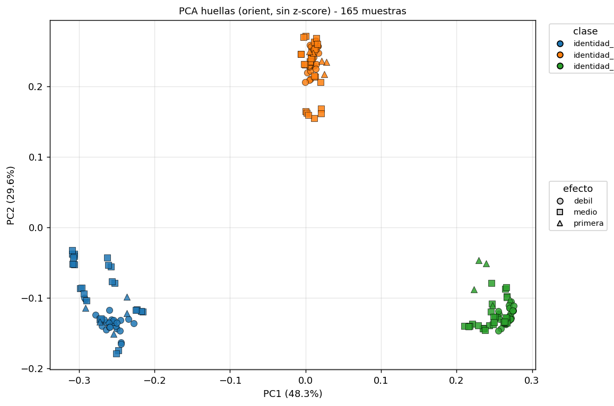

**PCA 2D de las huellas**

El gráfico muestra las 165 huellas proyectadas en dos componentes principales (PC1 48,3 % y PC2 29,6 %, juntas 77,9 % de la variación). El color indica la identidad y la forma del marcador indica el tipo de distorsión (primera, débil o medio).

*Qué se ve:* aparecen **tres grupos bien separados, uno por identidad**. Las huellas con distinta distorsión (débil, medio, primera) quedan mezcladas dentro del grupo de su identidad.

*Conclusión:* el vector de 104 números **captura lo que distingue a cada persona** y es poco sensible al giro, al ruido, a los rayones y a las traslaciones moderadas. Por eso el K-means puede agruparlas sin conocer las etiquetas.

*Limitación:* el gráfico muestra el 77,9 % de la variación. El resto no se ve, aunque el K-means sí lo usa.

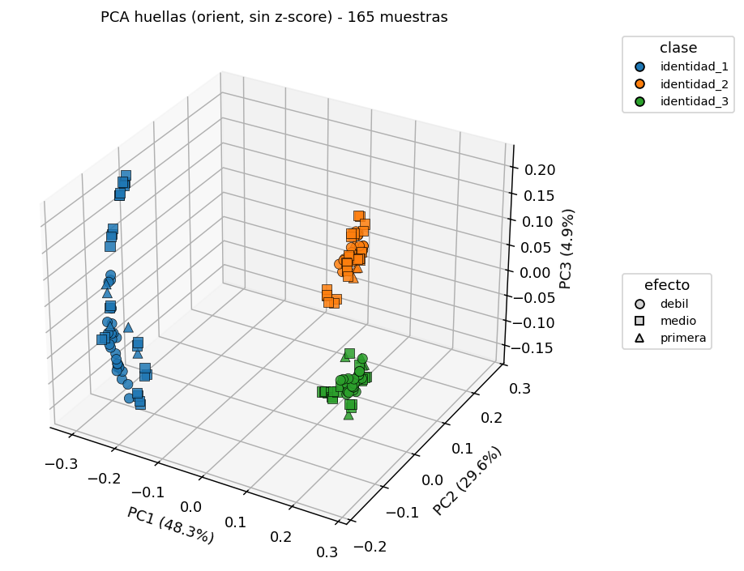

**PCA 3D de las huellas**

Es el mismo análisis con un tercer componente (PC3, 4,9 %). Entre los tres explican el 82,8 % de la variación. Se confirma la separación por identidad y sirve para mostrar que lo observado no depende del ángulo del gráfico.

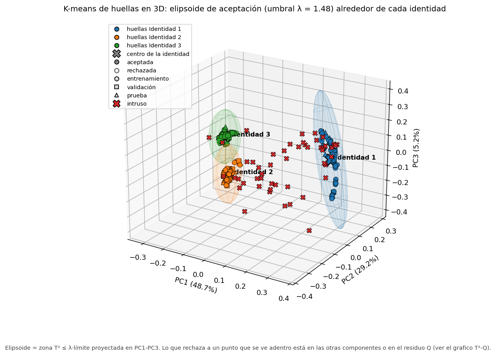

**Clusters de K-means con los elipsoides de aceptación**

Muestra los 3 centros de identidad (las X grandes), el **elipsoide de aceptación** de cada identidad ($\lambda$ = 1,48) y las huellas de entrenamiento (círculos), validación (cuadrados) y prueba (triángulos); los intrusos aparecen como X rojas. Los ejes son las tres primeras componentes del PCA del modelo, ajustado solo con las huellas de entrenamiento (PC1 48,7 %, PC2 29,2 % y PC3 5,2 %).

*Qué se ve:* cada identidad se agrupa alrededor de su centro, dentro de su elipsoide, y los intrusos quedan **lejos de los tres grupos**. Los elipsoides no son esferas: se alargan hacia donde cada identidad varía más, que es el efecto de la distancia de Mahalanobis.

*Qué se concluye:* el algoritmo encontró tres grupos que coinciden con las tres identidades reales (exactitud 100 % en las tres etapas) y la regla de decisión deja a los intrusos del lado rechazado. *Limitación:* el gráfico muestra solo 3 de las 6 componentes de la decisión, por lo que algún punto puede verse dentro de un elipsoide y estar rechazado por las componentes que no se dibujan.

### <u>PCA de los audios</u>

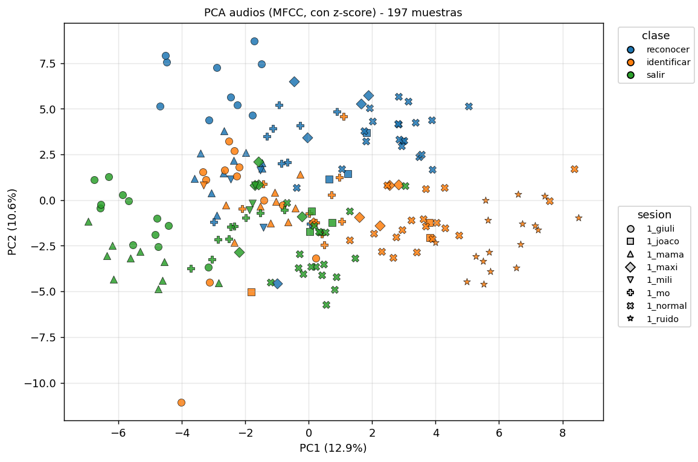

**PCA 2D de los audios**

El gráfico muestra los 197 audios en dos componentes (PC1 12,9 % y PC2 10,6 %, solo el 23,5 % de la variación). El color indica el comando y la forma indica la persona o sesión.

*Qué se ve:* los comandos **se solapan mucho**. Hay cierta estructura (por ejemplo, *salir* en verde tiende a la izquierda y *reconocer* en azul arriba), pero las nubes se mezclan. Lo que más se separa es **la persona**: la sesión `ruido` (estrellas) queda a la derecha y `mama` (triángulos) a la izquierda.

*Qué se concluye:* en esos dos componentes pesa más **quién habla** que **qué se dice**. Eso no significa que el KNN se confunda: usa los 91 números, mucho más información que lo que muestra este plano (en validación acierta 94,7 % y en prueba 90,9 %). Es una razón para separar los conjuntos por persona, y no al azar.

*Limitación:* los dos componentes explican solo el 23,5 % de la variación, por lo que no sirven para juzgar la calidad del clasificador.

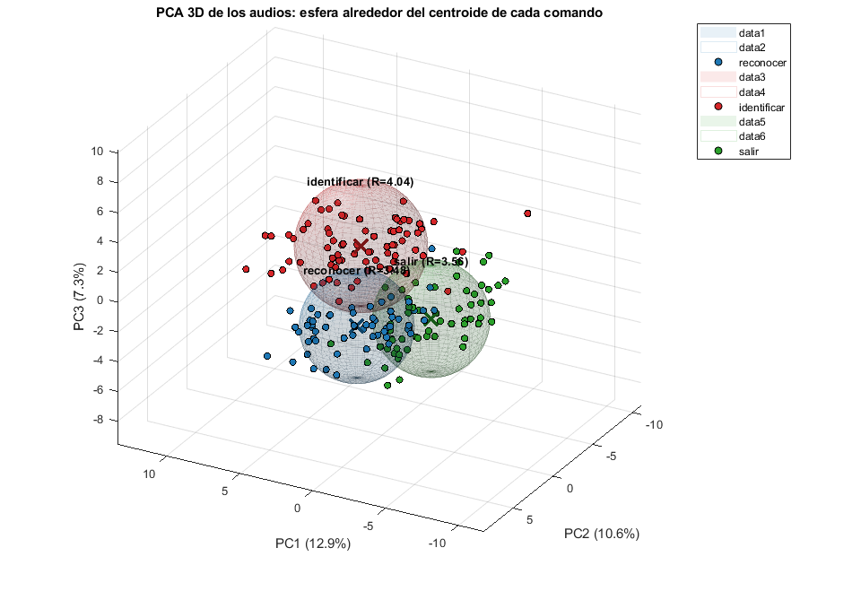

**PCA 3D de los audios con esferas (MATLAB)**

Muestra los 197 audios en tres componentes (30,8 % de la variación), con una esfera alrededor del centroide de cada comando. El radio es la distancia media de los audios al centroide, unos 3,5 a 4 unidades.

*Qué se ve:* las tres esferas **se solapan** bastante.

*Qué se concluye:* el solapamiento confirma lo visto en 2D: con tres componentes los comandos tampoco se separan de forma limpia. A diferencia de las huellas, **el KNN no usa centroides ni radios**. Decide por los vecinos más cercanos según la distancia euclídea. Las esferas son solo una ayuda visual para ver la dispersión de cada comando. Este es el contraste entre los dos métodos: en las huellas la separación sí se ve en el PCA, y en la voz hay que confiar en las métricas de clasificación.

---

# <u>4. Conclusiones</u>

## 4.1 Conclusiones generales

El sistema **funciona de manera satisfactoria**: identifica correctamente a las tres identidades a partir de la huella y reconoce los tres comandos de voz, y esto se puede validar con las métricas evaluadas (huellas: **100 %** de exactitud de identificación en entrenamiento, validación y prueba, con **0 de 25 intrusos aceptados** en la prueba y **2 de 33** autorizadas rechazadas; voz: **94,7 %** en validación y **90,9 %** en prueba con KNN). Las matrices de confusión muestran que los errores son pocos y puntuales, y que ninguna huella autorizada fue aceptada con la identidad equivocada.

Conviene interpretar el 100 % de las huellas con cuidado: se obtiene con datos sintéticos, con identidades de clases distintas y con distorsiones débiles y medias. No es una garantía para huellas reales ni para distorsiones fuertes. El objetivo no fue lograr la máxima robustez frente a cualquier distorsión, sino un sistema simple, explicable y que funcione bien en condiciones razonables.

## 4.2 Eficiencia

- **Huellas:** el preprocesamiento toma unos 0,11 s por imagen y la decisión es el cálculo de $T^2$ a solo 3 identidades, por lo que la respuesta es prácticamente inmediata. La generación de la huella con Anguli (2 s para una identidad, hasta 18 s para un intruso nuevo) es el paso más lento del flujo.
- **Voz:** el KNN con distancia euclídea compara cada audio contra los 197 de referencia usando vectores de 91 números, por lo que es muy rápido para comandos de 1,5 s.
- **Datos:** con pocos datos (165 huellas y 197 audios) se obtuvieron resultados aceptables, porque el acondicionamiento y la elección de las características se decidieron con mediciones.

## 4.3 Ventajas

1. **Integración directa con el generador de huellas:** el sistema se conecta con Anguli y permite generar una huella en el momento, incluso una identidad nueva.
2. **Configuración rápida del filtro:** se puede elegir a gusto el tipo de distorsión (débil o medio) para cada identidad, y **visualizar en vivo** la huella generada y la huella ya procesada.
3. **Transparencia del funcionamiento:** el sistema muestra cómo decide. En el **KNN** se ven las **votaciones** de los vecinos y su confianza; en las **huellas** se ve el puntaje de la huella contra el umbral y su posición respecto de la elipse de cada identidad. Esto favorece a quien quiera interesarse por el funcionamiento interno del algoritmo.
4. **Algoritmos propios y explicables:** K-means y KNN están programados desde cero y comentados paso a paso, y se basan en métodos científicos reconocidos (filtro de Gabor, MFCC, PCA, distancia de Mahalanobis, algoritmo húngaro).
5. **Umbral calibrado con datos:** el umbral se fija con una regla clara (el mayor valor que no acepta a ningún intruso de calibración) y se verifica con intrusos distintos.
6. **Seguridad en el control por voz:** un comando solo se ejecuta si los tres vecinos coinciden, lo que reduce las acciones por errores de reconocimiento.
7. **Procesamiento incremental y modular:** cada etapa es un script independiente que solo procesa lo nuevo y no modifica los datos originales, por lo que se puede ampliar el dataset sin rehacer todo.

## 4.4 Desventajas (aspectos a mejorar)

1. **No se utilizaron huellas reales.** Todas son sintéticas, generadas con Anguli, y las distorsiones son las propias del programa, por lo que no hay certeza de que reflejen la variabilidad real (piel seca, presión, distintos sensores). Aun así, el sistema se apoya en métodos científicos, por lo que se espera que las aproximaciones sean buenas.
2. **Voz probada con un solo micrófono.** Los audios se grabaron con un único micrófono USB y relativamente cerca de la boca; por eso los resultados dependen de que la calidad de audio sea buena desde el origen. No se probó en ambientes ruidosos ni con otros tipos de micrófono.
3. **El KNN siempre responde con un comando conocido.** Por el propio funcionamiento del algoritmo, si se dice otra palabra devuelve el comando que más se parece entre los que conoce. Este caso no se tuvo en cuenta durante el desarrollo.
4. **Distorsiones fuertes.** El sistema se entrenó con distorsiones débiles y medias; con distorsión fuerte (giro de 30° y traslación de 60 px a la vez) rechaza a la mayoría de las autorizadas (12 de 15 en una prueba).
5. **Identidades de clases distintas.** Las tres identidades son de clases de huella distintas, lo que facilita separarlas. Con identidades más parecidas entre sí la separación podría ser menor.
6. **Pocos datos.** La prueba de voz tiene 22 audios y la de huellas 33 más 25 intrusos; las cifras son estimaciones con incertidumbre. Además el umbral depende del intruso de calibración más cercano (puntaje 1,48), por lo que conviene confirmarlo con más intrusos.

## 4.5 Trabajos a futuro

| Aspecto a mejorar | Posible solución |
| --- | --- |
| Datos sintéticos | Probar con huellas reales (por ejemplo, bases públicas de huellas) y con otros generadores |
| Calidad de audio | Grabar con distintos micrófonos, distancias y ambientes ruidosos; sumar más personas |
| Palabras desconocidas | Agregar una clase **“otros”** (otras palabras, silencio y ruido) para rechazar lo que no es un comando |
| Distorsiones fuertes | Incluir el nivel fuerte y huellas recortadas en el entrenamiento |
| Identidades parecidas | Evaluar el sistema con identidades de la misma clase y comparar Mahalanobis con la distancia euclídea en ese caso |
| Umbral | Reunir más intrusos para confirmar el valor de $\lambda$ |
| Evaluación | Ampliar los conjuntos de prueba para obtener métricas más precisas |

---

# <u>5. IA generativa</u>

## 5.1 Herramientas y uso realizado

| Etapa | Herramienta | Uso realizado |
| --- | --- | --- |
| **Investigación inicial** | **Gemini (Deep Research)**, Google | Investigación de las técnicas más adecuadas para la **caracterización de huellas y de voz**, y de la mejor forma de generar **huellas sintéticas**. De ahí salieron las familias de rasgos que luego se compararon (orientación de crestas, FingerCode, HOG, minucias; MFCC y Δ) y la elección de Anguli como generador |
| **Desarrollo** | **Claude Code** (Anthropic), dentro de Visual Studio Code | Escritura, comentado y ejecución del código en Python: preprocesamiento, vectorización, K-means y KNN desde cero, regla de decisión, gráficos, scripts de prueba e interfaz. También redacción de la documentación y de borradores del informe |

El desarrollo se hizo **siguiendo el cronograma presentado por la cátedra** y por etapas: acondicionamiento, caracterización, clasificación, prueba del umbral y, por último, la interfaz. En cada etapa se pidió un resultado, se lo revisó y recién entonces se pasó a la siguiente.

## 5.2 Ejemplos de prompts utilizados

Se transcriben tal como se escribieron.

**Prompt 1: orden de los datos (inicio del proyecto)**
> ordena la carpeta de proyecto final, en finger prints tengo las bases de las huellas eso dejalo tal cual, crea una carpeta que tenga fingerprint directori y copia y pega esas 3 imagenes ahi tambien, luego la carpeta impression 1 a 5, tienen dentro las respectivas a los fingerprint, crea 3 carpetas donde tengan las impresiones de 1 2 y 3 por separado, en metainfo metelo en la carpeta de fingerprints

**Prompt 2: preacondicionamiento de las huellas**
> Ahora vamos a solucionar solo la parte del proyecto referida al preacondicionamiento, para luego realizar las etiquetas y posteriormente realizar las clases y aplicar K-means. El archivo de agrupamiento de huellas es una investigación de las técnicas más utilizadas, el programa no tiene que ser extremadamente robusto sino que funcione bien, por lo tanto analiza prueba cuáles son los métodos que usaremos, mínimamente: Reajuste de imagen (para las trasladadas y rotadas), Escala de grises (para mejorar la saturación), Filtrado, Binarización. Analiza la mejor manera de arreglar las que tienen mucho ruido o rayones.

**Prompt 3: corrección del algoritmo y filtros de la interfaz**
> el algoritmo falla para el efecto de traslacion, (se mueve el centro de la huella) como se podria arreglar esto, ademas, modifica en la interfaz los filtros que se pueden usar, que sea un conjunto de todos pero en distintos rangos, filtro debil, filtro medio, filtro fuerte. En teoria de metodos agrega claramente que filtrado y reacondicionamiento se utilizan tanto en huellas como en voz, por que queda la cantidad de componentes de cada vector en la binarizacion de huella y voz.

**Prompt 4: explicación de los gráficos**
> hace un .md “GRAFICOS” QUE EXPLIQUE QUE SE GRAFICA HASTA AHORA. que significa cada eje, que grupo de datos se utiliza, que son vectores? que componente utiliza esos vectores, que son los porcentajes que salen, que conclusion se saca de ellos

**Prompt 5: resultados y visualización 3D**
> vamos con la parte de resultados obtenidos. Presente estadísticas de las clasificaciones realizadas. Debe incluir un análisis por componentes principales y mostrar gráficamente la separación de clases obtenidas. Comente los resultados obtenidos. […] además dame un script que pueda pegar en matlab así visualizo en 3d el gráfico pca de las voces y que se vean las esferas que rodean los centroides.

**Prompt 6: nuevo dataset**
> para mejorar el dataset vamos a rehacer el dataset y usar 3 identidades base nuevas creadas con anguli reemplazando las anteriores, y rehacer todo de vuelta, entrenamiento prueba, los intrusos dejalos, gráficos umbral etc, con el fin de ver si se separan más los clusters ya que el problema base puede ser que sean parecidas

## 5.3 Cómo se verificaron las respuestas y el código generado

1. **Ejecución del código antes de entregarlo.** Por ser código en Python, Claude Code lo ejecutaba en el momento y mostraba el resultado real (salidas, errores, gráficos). Los errores aparecidos se corrigieron y se volvió a ejecutar (por ejemplo, un error de sintaxis que se detectó al correr un script y la traslación que fallaba).
2. **Mediciones en lugar de suposiciones.** Las decisiones se tomaron comparando alternativas con los datos: cinco métodos de filtrado sobre las huellas, varias familias de rasgos con K-means, distintos vectores y distancias en el KNN, y la distancia euclídea contra la de Mahalanobis para el umbral.
3. **Datos separados para evaluar.** Las huellas se evaluaron con impresiones que no se usaron para entrenar y con intrusos distintos de los de calibración, y los audios con **personas distintas** en entrenamiento, validación y prueba. La prueba se usa una sola vez.
4. **Métricas y matrices de confusión** (exactitud, F1, autorizadas rechazadas e intrusos aceptados) para detectar errores que un porcentaje solo oculta.
5. **Verificación visual.** Se miraron las imágenes procesadas y los gráficos (PCA, clusters, interfaz) para comprobar que coincidieran con lo esperado; por ejemplo, un punto rechazado que se veía dentro de la zona de aceptación en el PCA llevó a mostrar también el gráfico de puntaje contra umbral.
6. **Pruebas automáticas y manuales de la interfaz.** Se corrió el recorrido completo (generar huella → reconocer → identificar) de forma automática con capturas, y además se generaron huellas nuevas con la interfaz para medir el acierto del sistema, lo que permitió detectar que el nivel de filtro fuerte no estaba cubierto por el entrenamiento.
7. **Revisión del estudiante.** Cada etapa fue revisada y, cuando algo no se entendía o no convencía, se pidió una explicación o un cambio.

---

# Bibliografía y referencias

**Material de la cátedra**

1. Rivera, S. S. *Inteligencia Artificial I – Clase 1: Agentes inteligentes* (diapositivas). Ingeniería en Mecatrónica, Facultad de Ingeniería, UNCuyo. Tipos de agentes, tabla REAS y propiedades del entorno.
2. Rivera, S. S. *Inteligencia Artificial I – Clase 9: Aprendizaje* (diapositivas). Facultad de Ingeniería, UNCuyo. Aprendizaje automático, K-means y KNN.
3. Russell, S. y Norvig, P. *Artificial Intelligence: A Modern Approach*, 4.ª ed. Pearson, 2021 (bibliografía citada en la Clase 1).

**Técnicas utilizadas (agregadas para la decisión con Mahalanobis)**

1. Mahalanobis, P. C. “On the generalised distance in statistics”. *Proceedings of the National Institute of Sciences of India*, 2(1), 1936. (Distancia de Mahalanobis.)
2. Hotelling, H. “The generalization of Student’s ratio”. *Annals of Mathematical Statistics*, 2(3), 1931. (Estadístico $T^2$.)
3. Jolliffe, I. T. *Principal Component Analysis*, 2.ª ed. Springer, 2002. (PCA.)

**Software y herramientas**

1. Anguli: generador de huellas dactilares sintéticas. **[completar: autor/sitio y versión]**
2. Google. *Gemini – Deep Research* (investigación inicial de técnicas). **[completar: fecha de uso]**
3. Anthropic. *Claude Code* (asistente de programación con IA generativa), usado en Visual Studio Code. **[completar: modelo y fechas]**
4. Bibliotecas de Python: NumPy, SciPy, OpenCV, Matplotlib (Hunter, 2007), scikit-learn (Pedregosa et al., *JMLR*, 12, 2011; usado para el PCA de los gráficos y para comparar familias de rasgos) y Tkinter (interfaz).
